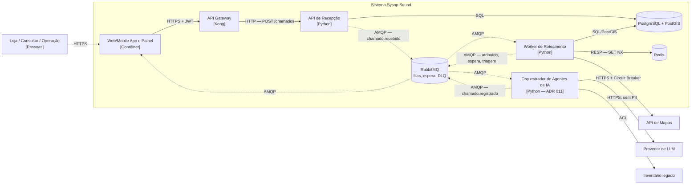
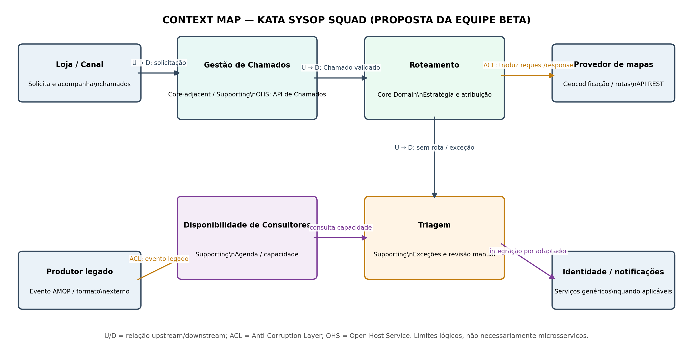

# Projeto Architectural Kata — Sysop Squad

**Disciplina:** Arquitetura de Software | **Período:** 6º Período — Engenharia de Software
**Turma:** Quarta-feira | **Sprint / Entrega:** Sprint 4 — Final do Projeto por Equipes

## Identificação da Equipe

**Equipe Beta**

| Nome do Integrante | Função na Sprint 4 (Liderança / Pesquisador / Executor) | GitHub |
|---|---|---|
| Felipe Pampu | Líder & Arquiteto Principal | [FelpisLipe](https://github.com/FelpisLipe) |
| Lucas Delles | Pesquisador & Modelagem DDD | [DellesLucas](https://github.com/DellesLucas) |
| Lucas Michael | Pesquisador & Engenheiro de Resiliência & Integração | [LucasMichaelFelismino](https://github.com/LucasMichaelFelismino) |
| Rhuan | Executor & Especialista em IA-Native & Autonomia / Executor & QA & Desenvolvedor de Fitness Functions | [RhuanBaungartner](https://github.com/RhuanBaungartner) |

O modelo prevê cinco funções e a equipe tem quatro integrantes, por isso uma pessoa acumula duas.

### Estrutura do repositório

| Pasta | Bloco da disciplina | Conteúdo |
|---|---|---|
| [sprint-1](sprint-1) | Bloco 1: Fundamentos, Drivers e Decisões | Domínio, Mini-QAW, BOTE, ADRs 000–003, C4 níveis 1 e 2 |
| [sprint-2](sprint-2) | Bloco 2: Estrutura, Padrões e Modelagem | SOLID/DIP, ADRs 004–005, validação quantitativa, primeiro código |
| [sprint-3](sprint-3) | Bloco 3: Distribuição, Domínio e Integração | Roteiro Prático (C4, Contrato de Dados, Retry), ADRs 004–009 |
| [sprint-4](sprint-4) | Bloco 4: Evolução, Governança e Tendências | Código final, ADRs 010–012, C4 final |

Cada sprint tem um `README.md`, os documentos em Markdown em `docs/` e os Word originais em `entregas/`.

---

## 1. Visão Geral do Sistema e Domínio de Negócio

### 1.1. Contexto do Projeto Selecionado

**Architectural Kata:** Sysop Squad (Suporte Técnico e Ticketing)

**Desafio Principal de Engenharia:** Criar a arquitetura de triagem e roteamento inteligente de chamados técnicos, utilizando classificação por IA multi-agente integrada a sistemas legados de inventário. O sistema conecta cerca de 800 lojas a 1.500 consultores de TI em operação nacional e precisa:
- aceitar chamados mesmo em picos de ~200 RPS ou com o roteamento fora do ar;
- nunca atribuir o mesmo consultor a dois chamados;
- tratar a localização dos consultores conforme a LGPD.

**Entregáveis do desafio:**
- Diagrama C4 Nível 2: [C4 Nível 2](sprint-4/docs/c4-nivel2.md)
- Pipeline RabbitMQ com DLQ e Retry Exponencial: [ADR 010](sprint-4/docs/adr/ADR-010-rabbitmq-dlq-e-retry-exponencial.md)
- ADR do ecossistema de agentes: [ADR 011](sprint-4/docs/adr/ADR-011-ecossistema-de-agentes-de-ia.md)
- Padrão GoF State no ciclo de vida dos chamados: [ADR 012](sprint-4/docs/adr/ADR-012-padrao-state-ciclo-de-vida-do-chamado.md)

### 1.2. Resumo da Solução Proposta

A solução é um **Monólito Modular em camadas** (ADR 006 da Sprint 3) com **arquitetura orientada a eventos no fluxo crítico** (ADR 000). A loja envia o chamado pelo API Gateway (Kong) para a API de Recepção. A API valida o Contrato de Dados, grava o chamado no PostgreSQL, publica no RabbitMQ e responde **202 Accepted** em poucos milissegundos, sem esperar o roteamento. Um Worker de Roteamento consome a fila e roda o **Motor de Roteamento**, que é o Core Domain: busca consultores elegíveis por raio e habilidade (PostGIS), ordena pelo tempo de deslocamento (API de Mapas, protegida por Circuit Breaker) e reserva o consultor de forma atômica no Redis.

A resiliência segue a Política de Retry e Fallback da Sprint 3. Falhas transitórias voltam para a fila após ~1 s e ~2 s (backoff exponencial com jitter). Na 3ª falha, ou com o circuito aberto, o chamado vai para a **triagem manual**. Mensagens irrecuperáveis vão para a **DLQ**. O ciclo de vida do chamado usa o **padrão State**, o que também dá idempotência: a mesma mensagem nunca gera dois roteamentos.

A camada de IA (ADR 011) é um **orquestrador multi-agente** fora do caminho crítico:
- um agente classificador (LLM com saída validada por JSON Schema);
- um agente de inventário que acessa o sistema legado por uma Camada Anti-Corrupção;
- um agente de conhecimento (RAG).

A IA apenas recomenda habilidades e prioridade. Quem escolhe o consultor continua sendo o motor determinístico.

---

## 2. Atributos de Qualidade e Matriz QAW

Os atributos de qualidade prioritários foram definidos na Sprint 1 ([Mini-QAW](sprint-1/README.md#2-mini-qaw-drivers-críticos-priorizados)) com base nos trade-offs essenciais do sistema:

| Atributo de Qualidade | Cenário Padronizado (Fonte → Estímulo → Artefato → Ambiente → Resposta) | Medida da Resposta (Métrica Objetivo) |
|---|---|---|
| **P1 — Disponibilidade sob alta carga** | Lojas e monitoramento → pico de ~200 req/s → API de Recepção e broker → horário de pico ou incidente nacional → valida, persiste, publica em fila durável e confirma o aceite sem esperar o roteamento | 99,9% de disponibilidade mensal; aceite em até 500 ms no p95; nenhum chamado aceito descartado |
| **P2 — Degradação graciosa (resiliência)** | Falha de infraestrutura → Motor de Roteamento ou API de Mapas indisponível → motor, broker e API → operação contínua → chamado continua na fila, retry limitado e depois triagem manual | Nenhum HTTP 5xx na abertura por falha do roteamento; triagem manual em até 2 s após a falha ser reconhecida (retries esgotados ou circuito aberto) |
| **P3 — Privacidade (LGPD)** | Job de retenção → GPS atinge 30 dias → histórico de localização → background → elimina ou anonimiza | Em até 24 h após 30 dias, nenhuma associação entre latitude/longitude e consultor identificado; PII removida antes de qualquer envio a LLM (ADR 011) |

---

## 3. Visão Geral da Arquitetura (Modelo C4)

A arquitetura está documentada conforme as abstrações do Modelo C4:

- 📄 **Nível 1 — Diagrama de Contexto:** [sprint-1](sprint-1/README.md#nível-c1--contexto)
- 📄 **Nível 2 — Diagrama de Contêineres:** [sprint-4/docs/c4-nivel2.md](sprint-4/docs/c4-nivel2.md) (protocolos e temporalidade mapeados na [Sprint 3](sprint-3/docs/01-mapeamento-c4-nivel-2.md))
- 📄 **Nível 3 — Diagrama de Componentes:** [sprint-4/docs/c4-nivel3.md](sprint-4/docs/c4-nivel3.md)

### Visualização do Diagrama de Contêineres (C4 — Nível 2)

Linha contínua = síncrono; linha tracejada = assíncrono.



---

## 4. Domain-Driven Design (DDD) & Limites de Contexto

**Documentação completa em** [ADR 004 da Sprint 3 — Bounded Contexts e Linguagem Ubíqua](sprint-3/docs/adr/ADR-004-bounded-contexts-e-linguagem-ubiqua.md).

### 4.1. Classificação dos Subdomínios

- **Core Domain (Domínio Principal):** Roteamento e Atribuição Inteligente. Código em [`sprint-4/src/sysop_squad/dominio`](sprint-4/src/sysop_squad/dominio).
- **Supporting Subdomain (Suporte):**
  - Gestão do Ciclo de Vida do Chamado ([`chamados`](sprint-4/src/sysop_squad/chamados));
  - Triagem e Tratamento de Exceções;
  - Disponibilidade e Capacidade dos Consultores.
- **Generic Subdomain (Genérico):**
  - Autenticação/autorização (JWT no Kong);
  - Geocodificação e rotas (API de Mapas);
  - Notificações e mensageria;
  - Persistência, cache e observabilidade.

### 4.2. Mapa de Contexto e Camada Anti-Corrupção (ACL)



O sistema integra-se a serviços externos e legados utilizando o padrão **Anti-Corruption Layer (ACL)**, com adaptadores GoF (Adapter Pattern) que isolam a Linguagem Ubíqua do núcleo do sistema:

| Fronteira | Adaptador / ACL | Situação |
|---|---|---|
| API de Mapas (OSRM) → Roteamento | [`infra/rotas_maps_http.py`](sprint-4/src/sysop_squad/infra/rotas_maps_http.py): traduz a resposta externa em tempo de deslocamento do domínio | Implementado |
| Contrato público HTTP → Gestão de Chamados (OHS) | [`apresentacao/api.py`](sprint-4/src/sysop_squad/apresentacao/api.py): traduz o DTO OpenAPI (`idExterno`, `loja`, `incidente`) no `Chamado` interno | Implementado |
| Inventário legado → Triagem | Agente de Inventário do [ADR 011](sprint-4/docs/adr/ADR-011-ecossistema-de-agentes-de-ia.md) | Projetado |

---

## 5. Padrões de Projeto & Princípios SOLID

### 5.1. Princípios SOLID Aplicados

- **Dependency Inversion Principle (DIP):** o domínio declara as interfaces de repositórios e serviços ([`dominio/portas.py`](sprint-4/src/sysop_squad/dominio/portas.py), [`chamados/portas.py`](sprint-4/src/sysop_squad/chamados/portas.py)), e a infraestrutura provê a implementação concreta ([`infra/`](sprint-4/src/sysop_squad/infra)). Decisão no [ADR 004 da Sprint 2](sprint-2/docs/adr/ADR-004-isolamento-do-dominio-por-interfaces.md).
- **Open/Closed Principle (OCP):** um critério de seleção novo é uma nova `EstrategiaDeSelecao`, e um estado novo do chamado é uma nova classe de estado, sem alterar o motor nem o contexto. [`tests/test_estrategia.py`](sprint-4/tests/test_estrategia.py) mostra a troca de estratégia sem mexer no motor.

### 5.2. Catálogo de Padrões GoF Utilizados

| Padrão GoF | Categoria | Localização no Código | Problema de Engenharia Resolvido |
|---|---|---|---|
| Factory Method | Criacional | [`apresentacao/composicao.py`](sprint-4/src/sysop_squad/apresentacao/composicao.py) — `criar_provedor_de_rotas` | Escolher a implementação de rotas por ambiente (API de Mapas com Circuit Breaker ou estimativa local) sem acoplar o domínio a classes concretas. [ADR 007](sprint-3/docs/adr/ADR-007-factory-method.md) |
| Adapter | Estrutural | [`infra/`](sprint-4/src/sysop_squad/infra) — `ConsultoresPostGISAdapter`, `DisponibilidadeRedisAdapter`, `MapsHTTPAdapter`, `ChamadosPostgresAdapter`, `TriagemAMQPAdapter` | Traduzir PostGIS, Redis, HTTP e AMQP para os contratos do domínio. [ADR 008](sprint-3/docs/adr/ADR-008-adapter.md) |
| Proxy | Estrutural | [`infra/circuit_breaker.py`](sprint-4/src/sysop_squad/infra/circuit_breaker.py) — `CircuitBreakerDeRotas` | Interromper chamadas à API de Mapas degradada sem o motor perceber a diferença |
| Strategy | Comportamental | [`dominio/estrategias.py`](sprint-4/src/sysop_squad/dominio/estrategias.py) — `MenorTempoDeDeslocamento` | Eliminar condicionais sobre o critério de seleção de consultores. [ADR 009](sprint-3/docs/adr/ADR-009-strategy.md) |
| State | Comportamental | [`chamados/ciclo_de_vida.py`](sprint-4/src/sysop_squad/chamados/ciclo_de_vida.py) — `CicloDeVidaDoChamado` | Ciclo de vida do chamado sem `if/else` sobre status; transições inválidas recusadas; idempotência do consumidor. [ADR 012](sprint-4/docs/adr/ADR-012-padrao-state-ciclo-de-vida-do-chamado.md) |

---

## 6. Resiliência, Integração e IA-Native

### 6.1. Padrões de Resiliência Aplicados

- **Circuit Breaker & Fallback:** implementado em Python em [`infra/circuit_breaker.py`](sprint-4/src/sysop_squad/infra/circuit_breaker.py), com estados fechado, aberto e meio-aberto. Fica na chamada HTTP síncrona à API de Mapas, que tem timeout de 1,5 s. Com o circuito aberto, o chamado vai direto para a triagem manual, que é o fallback. A política vem da [Sprint 3](sprint-3/docs/03-politica-retry-fallback.md).
- **Nivelamento de Carga (Load Leveling):** o RabbitMQ absorve os picos (a API só publica e responde 202). O pipeline tem:
  - **retry exponencial** por filas de espera de 1 s e 2 s com jitter;
  - **Content-Based Router** por prioridade;
  - **Dead Letter Queue** para mensagens irrecuperáveis.

  Detalhes no [ADR 010](sprint-4/docs/adr/ADR-010-rabbitmq-dlq-e-retry-exponencial.md).
- **Idempotência:**
  - `idExterno` único (HTTP 409);
  - reserva de consultor idempotente no Redis;
  - estado do ciclo de vida que descarta reentregas.

### 6.2. Componente de Inteligência Artificial Generativa

- **Arquitetura AI-Native:** orquestrador **multi-agente** ([ADR 011](sprint-4/docs/adr/ADR-011-ecossistema-de-agentes-de-ia.md)) com:
  - Agente Classificador (LLM com *model tiering*: modelo pequeno primeiro, maior só quando a confiança é baixa);
  - Agente de Inventário (ACL para o sistema legado);
  - Agente de Conhecimento (RAG com `pgvector` sobre chamados resolvidos).

  Roda fora do caminho crítico da API e só recomenda; o Motor de Roteamento continua determinístico.
- **Guardrails & Segurança:**
  - saídas estruturadas validadas via JSON Schema;
  - lista fechada de habilidades e categorias;
  - limiar de confiança com envio à triagem manual;
  - higienização prévia de PII antes do envio aos modelos (LGPD, P3);
  - timeout e Circuit Breaker no provedor de LLM, com fallback para a classificação informada pela loja.

---

## 7. Registros de Decisões Arquiteturais (ADRs)

Todas as decisões estratégicas e seus trade-offs estão registradas nas pastas `docs/adr` de cada sprint. **Cada sprint manteve a numeração com que foi entregue**, por isso os números 004 e 005 aparecem na Sprint 2 e na Sprint 3 com decisões diferentes.

| Sprint | ADR | Título da Decisão Arquitetural | Status |
|---|---|---|---|
| 1 | [000](sprint-1/docs/adr/ADR-000-arquitetura-orientada-a-eventos.md) | Arquitetura Orientada a Eventos no Fluxo Crítico | Aceito |
| 1 | [001](sprint-1/docs/adr/ADR-001-object-storage-para-anexos.md) | Separação de Arquivos de Mídia (Object Storage) | Aceito |
| 1 | [002](sprint-1/docs/adr/ADR-002-message-broker.md) | Message Broker para Desacoplamento e Fallback | Aceito |
| 1 | [003](sprint-1/docs/adr/ADR-003-banco-geoespacial-e-cache.md) | Banco Geoespacial e Cache em Memória | Aceito |
| 2 | [004](sprint-2/docs/adr/ADR-004-isolamento-do-dominio-por-interfaces.md) | Isolamento do Domínio por Interfaces (DIP) | Aceito |
| 2 | [005](sprint-2/docs/adr/ADR-005-topologia-validada-por-metricas.md) | Topologia de Três Pacotes Validada por Métricas | Aceito |
| 3 | [004](sprint-3/docs/adr/ADR-004-bounded-contexts-e-linguagem-ubiqua.md) | Bounded Contexts, Subdomínios e Linguagem Ubíqua | Proposta |
| 3 | [005](sprint-3/docs/adr/ADR-005-frameworks-e-padroes-de-integracao.md) | Frameworks e Padrões de Integração (Kong, JWT, ACL, Content-Based Router) | Proposto |
| 3 | [006](sprint-3/docs/adr/ADR-006-macroarquitetura-e-distribuicao-de-dados.md) | Macroarquitetura (Monólito Modular) e Distribuição de Dados | Proposta |
| 3 | [007](sprint-3/docs/adr/ADR-007-factory-method.md) | Padrão Criacional: Factory Method | Proposta (implementado na Sprint 4) |
| 3 | [008](sprint-3/docs/adr/ADR-008-adapter.md) | Padrão Estrutural: Adapter | Proposta (implementado) |
| 3 | [009](sprint-3/docs/adr/ADR-009-strategy.md) | Padrão Comportamental: Strategy | Proposta (implementado na Sprint 4) |
| 3 | [s/ nº](sprint-3/docs/adr/ADR-retry-e-fallback.md) | Retry e Fallback (Registro de Decisão do Roteiro Prático) | Proposto (implementado na Sprint 4) |
| 4 | [010](sprint-4/docs/adr/ADR-010-rabbitmq-dlq-e-retry-exponencial.md) | RabbitMQ com Content-Based Router, Retry Exponencial e DLQ | Aceito |
| 4 | [011](sprint-4/docs/adr/ADR-011-ecossistema-de-agentes-de-ia.md) | Ecossistema de Agentes de IA para Triagem e Classificação | Proposto |
| 4 | [012](sprint-4/docs/adr/ADR-012-padrao-state-ciclo-de-vida-do-chamado.md) | Padrão State no Ciclo de Vida do Chamado | Aceito |

---

## 8. Testes & Fitness Functions (Governança Automatizada)

### 8.1. Execução das Fitness Functions

O projeto é em Python, então no lugar do ArchUnit (Java) usamos:
- o **import-linter**, com os contratos em [`sprint-4/pyproject.toml`](sprint-4/pyproject.toml);
- testes de arquitetura em [`sprint-4/tests/test_arquitetura.py`](sprint-4/tests/test_arquitetura.py).

Ambos rodam no GitHub Actions a cada push ([`.github/workflows`](.github/workflows)).

- **Regra Validada 1:** a camada de Domínio não possui referência direta para a camada de Infraestrutura. Isso é verificado por `test_regra_1_dominio_nao_referencia_infraestrutura`, por `test_regra_1_gestao_de_chamados_nao_referencia_infraestrutura` e pelos contratos *layers* e *forbidden* do import-linter.
- **Regra Validada 2:** todas as classes de repositório e adaptadores implementam uma interface abstrata correspondente. Isso é verificado por `test_regra_2_todo_adaptador_implementa_uma_porta`.
- **Invariantes do [ADR 005 da Sprint 2](sprint-2/docs/adr/ADR-005-topologia-validada-por-metricas.md):**
  - domínio com Ce = 0;
  - dependências sempre para pacotes mais estáveis;
  - distância do domínio ≤ 0,50, cumprida na Sprint 4.

  Calculadas por [`tools/metricas.py`](sprint-4/tools/metricas.py).

Para conferir que as regras pegam erro de verdade, foi inserida de propósito uma importação proibida no domínio, numa cópia do código. Os contratos quebraram e os testes falharam.

| Pacote | Ca | Ce | I | A | D |
|---|---|---|---|---|---|
| dominio | 9 | 0 | 0,00 | 0,50 | 0,50 |
| chamados | 3 | 0 | 0,00 | 0,18 | 0,82 |
| infra | 1 | 9 | 0,90 | 0,00 | 0,10 |
| apresentacao | 0 | 16 | 1,00 | 0,00 | 0,00 |

### 8.2. Como rodar

```bash
cd sprint-4
python -m venv .venv
.venv\Scripts\activate
pip install -e ".[dev,infra]"
pytest              # 96 testes
lint-imports        # contratos de camadas
python tools/metricas.py
```

---

## Como a equipe contribui

Fluxo combinado em aula: **branch → commit → Pull Request → aprovação → merge na `main`**.

1. Cada integrante cria um branch a partir da `main` (`git switch -c nome-do-branch`).
2. Faz commits só nos arquivos da sua parte.
3. Abre um Pull Request para a `main`.
4. Outro integrante revisa e aprova.
5. Merge. A `main` só recebe mudanças por PR aprovado.
