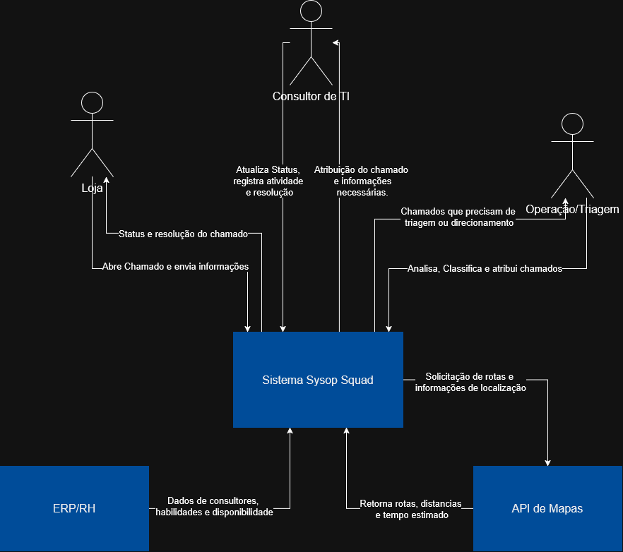
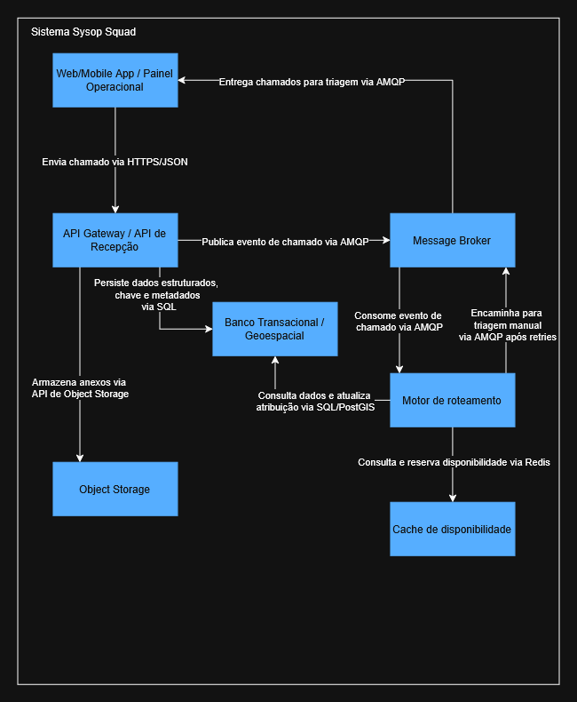

# Sprint 1 — Imersão no domínio, drivers, BOTE, ADRs e C4

**Projeto:** Sysop Squad · **Equipe Beta**

| Integrante | Papel na Sprint 1 |
|---|---|
| Rhuan | Líder da Sprint (ADR de estilo e ADRs) |
| Lucas Michael | Pesquisador |
| Lucas Delles | Executor (C4, níveis C1 e C2) |
| Felipe Pampu | Executor (C4, níveis C1 e C2) |

Documento original entregue: [entregas/Projeto Sysop Squad.docx](entregas/Projeto%20Sysop%20Squad.docx)

## 1. Imersão no Domínio

**Contexto Geral:** O sistema visa substituir processos manuais por um roteamento inteligente de chamados baseado em Localização, Habilidades e Disponibilidade, conectando aproximadamente 800 lojas a 1.500 consultores de TI em operação nacional.

- **Características Econômicas e Operacionais:** A indisponibilidade do sistema impede ou atrasa o registro e o encaminhamento de incidentes, podendo manter PDVs e equipamentos inoperantes, reduzir o faturamento das lojas e gerar ociosidade dos consultores. Por isso, disponibilidade e continuidade do serviço são drivers diretamente ligados ao negócio.
- **LGPD e Dados Pessoais de Geolocalização:** O sistema trata a localização dos consultores, que constitui dado pessoal quando associada a uma pessoa identificada ou identificável. A arquitetura deve aplicar finalidade, necessidade, controle de acesso, minimização e retenção limitada. Como política inicial do projeto, o histórico detalhado de GPS será mantido por até 30 dias e, depois, eliminado ou anonimizado, ressalvadas hipóteses de conservação legalmente justificadas. O prazo de 30 dias é uma decisão de retenção do projeto, e não um prazo geral imposto pela LGPD (Lei nº 13.709/2018, arts. 5º, 6º, 15 e 16).
- **Risco de Escala Nacional:** Eventos de grande impacto, como Black Friday ou incidentes simultâneos em múltiplas lojas, podem concentrar requisições em poucos minutos. O sistema deve continuar aceitando chamados mesmo quando componentes internos estiverem lentos ou temporariamente indisponíveis.

## 2. Mini-QAW: Drivers Críticos Priorizados

Critério de priorização: impacto direto no negócio, capacidade de interromper a operação nacional e risco técnico/legal. Os cenários abaixo seguem a estrutura Fonte do Estímulo, Estímulo, Artefato, Ambiente, Resposta e Medida da Resposta.

### Prioridade P1 — Driver 1: Disponibilidade sob Alta Carga (Uptime)

- **Justificativa da Prioridade:** Se a entrada de chamados ficar indisponível, as lojas perdem o principal canal de acionamento do suporte, com impacto direto na continuidade operacional e no faturamento.
- **Fonte do Estímulo:** Lojas, aplicações clientes e monitoramento automatizado abrindo ou atualizando chamados simultaneamente.
- **Estímulo:** Pico de até aproximadamente 200 requisições por segundo, conforme a estimativa BOTE e o fator de segurança adotado para eventos de alta concentração.
- **Artefato:** API de Recepção / API Gateway e Message Broker.
- **Ambiente:** Operação em horário de pico ou incidente nacional, com o Motor de Roteamento sob carga elevada.
- **Resposta:** A API valida o mínimo necessário, persiste/publica o chamado em fila durável e confirma o aceite de forma assíncrona, sem depender da conclusão imediata do roteamento.
- **Medida da Resposta:** Endpoint de abertura com SLO inicial de 99,9% de disponibilidade mensal; confirmação de aceite em até 500 ms no p95; após a confirmação de persistência no broker, nenhum chamado aceito pode ser descartado silenciosamente.

### Prioridade P2 — Driver 2: Degradação Graciosa (Resiliência)

- **Justificativa da Prioridade:** A falha do roteamento inteligente não pode impedir a abertura do chamado; o serviço deve perder sofisticação antes de perder a função essencial.
- **Fonte do Estímulo:** Falha de infraestrutura, timeout ou indisponibilidade do Motor de Roteamento.
- **Estímulo:** O serviço responsável por calcular localização, habilidade e disponibilidade fica indisponível ou excede o limite de processamento.
- **Artefato:** Motor de Roteamento, Message Broker e API de Recepção.
- **Ambiente:** Operação contínua, inclusive durante alta carga.
- **Resposta:** O chamado permanece persistido na mensageria. Após falha/retries controlados, o ticket é direcionado para uma fila de triagem manual, permitindo que a loja continue registrando incidentes enquanto o roteamento automático se recupera.
- **Medida da Resposta:** A indisponibilidade isolada do Motor de Roteamento não deve gerar erro HTTP 5xx na abertura de chamados; fallback para triagem manual ativado em até 2 segundos após a condição de falha ser reconhecida; tickets aceitos permanecem disponíveis para reprocessamento.

### Prioridade P3 — Driver 3: Privacidade e Conformidade (LGPD)

- **Justificativa da Prioridade:** O uso de geolocalização em escala nacional aumenta o impacto de acesso indevido, retenção excessiva e tratamento incompatível com a finalidade, criando risco jurídico e reputacional.
- **Fonte do Estímulo:** Processo automatizado de retenção (job agendado) e políticas de governança de dados.
- **Estímulo:** Registros detalhados de geolocalização atingem o limite de retenção de 30 dias definido pelo projeto.
- **Artefato:** Banco de Dados Geoespacial / histórico de localização.
- **Ambiente:** Operação em background, sem interromper o atendimento de chamados.
- **Resposta:** O sistema elimina ou anonimiza os dados detalhados de GPS que não possuam justificativa de conservação, de modo que não seja razoavelmente possível reidentificar o consultor, mantendo apenas informações agregadas quando necessárias para métricas operacionais.
- **Medida da Resposta:** Até 24 horas após um registro completar 30 dias, os dados submetidos à política não podem mais permitir associação razoável entre latitude/longitude histórica e um consultor identificado.

## 3. Análise BOTE (Back-of-the-Envelope)

**Premissas de Projeto:** 800 lojas; 1.500 consultores; 40 chamados/dia por loja; ticket estruturado com aproximadamente 5 KB; 30% dos tickets com um anexo fotográfico médio de 2 MB; atualização de localização a cada 30 segundos durante o período ativo; fator de segurança de 4x sobre a carga contínua principal para dimensionamento inicial de pico.

| Métrica | Cálculo / Estimativa | Resultado |
|---|---|---|
| Volume Diário de Tickets | 40 chamados/dia por loja x 800 lojas | 32.000 tickets/dia |
| RPS — Abertura de Tickets (média 24h) | 32.000 / 86.400 segundos | ~0,37 RPS |
| RPS — Atualização de Localização | 1.500 consultores / 30 segundos | ~50 RPS |
| RPS — Carga Base Quantificada | 50 RPS de localização + 0,37 RPS de abertura | ~50,4 RPS |
| RPS — Pico de Projeto | Carga base x fator de segurança 4x para concentração de tráfego e demais operações | ~200 RPS |
| Armazenamento de Texto (5 anos) | 32.000 x 365 x 5 = 58,4 milhões de tickets; ~5 KB cada | ~292 GB |
| Armazenamento de Mídia (5 anos) | 58,4 milhões x 30% x 2 MB | ~35 TB |

**Conclusão BOTE:** A carga contínua já é dominada pelas atualizações de localização (~50 RPS), enquanto a criação média de tickets é pequena (~0,37 RPS). Para eventos concentrados e demais operações da API, o projeto adota capacidade inicial de aproximadamente 200 RPS, a ser validada por teste de carga. Em armazenamento, o maior volume está nos anexos (~35 TB em 5 anos), e não nos dados estruturados (~292 GB). Esses valores representam volume lógico bruto e não incluem réplicas, backups, logs ou overhead de índices.

## 4. Architecture Decision Records (ADRs)

Os ADRs abaixo registram decisões arquiteturais derivadas diretamente dos drivers do Mini-QAW e das estimativas BOTE. O ADR 000 formaliza o estilo arquitetural predominante do fluxo crítico de chamados, conforme responsabilidade do Líder da Sprint.

| ADR | Decisão | Status |
|---|---|---|
| [ADR 000](docs/adr/ADR-000-arquitetura-orientada-a-eventos.md) | Adoção de Arquitetura Orientada a Eventos no Fluxo Crítico | Aceito |
| [ADR 001](docs/adr/ADR-001-object-storage-para-anexos.md) | Separação de Arquivos de Mídia (Object Storage) | Aceito |
| [ADR 002](docs/adr/ADR-002-message-broker.md) | Adoção de Message Broker para Desacoplamento e Fallback | Aceito |
| [ADR 003](docs/adr/ADR-003-banco-geoespacial-e-cache.md) | Banco Geoespacial e Cache em Memória para Roteamento | Aceito |

## 5. Modelo C4 (C1 e C2)

Para o mapeamento estrutural das decisões tomadas, a equipe utilizou somente os níveis C1 (Contexto) e C2 (Contêineres) nesta Sprint.

### Nível C1 — Contexto

### Nível C2 — Contêineres

## 6. Referências

- BRASIL. Lei nº 13.709, de 14 de agosto de 2018. Lei Geral de Proteção de Dados Pessoais (LGPD), especialmente arts. 5º, 6º, 15 e 16.
- SOFTWARE ENGINEERING INSTITUTE (SEI/Carnegie Mellon University). *Quality Attribute Workshops (QAWs)*, Third Edition. CMU/SEI-2003-TR-016, 2003.
