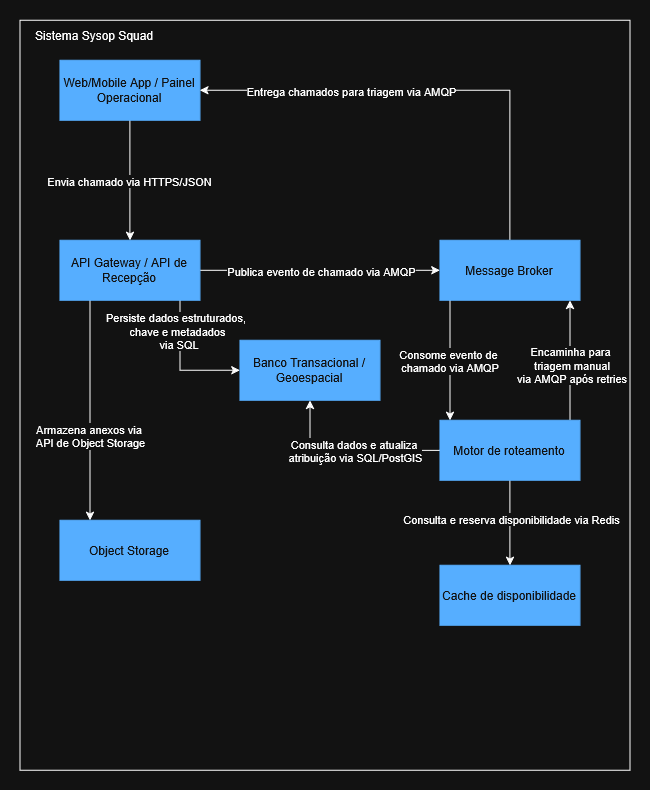
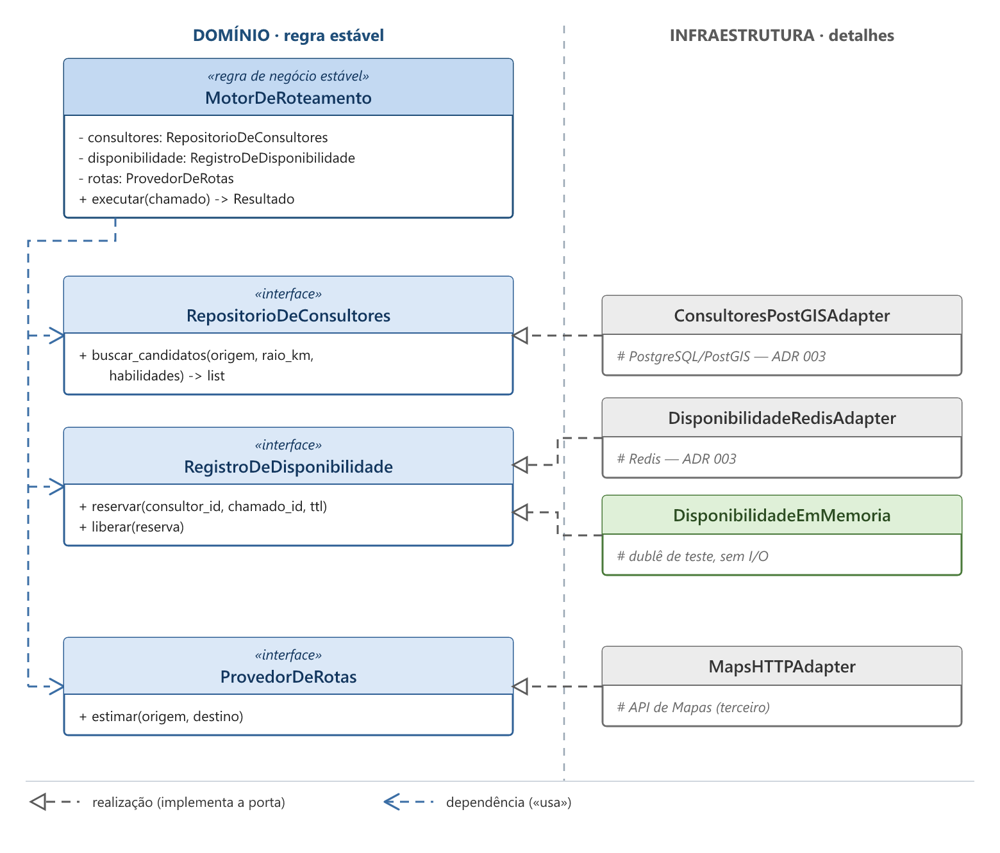

# Barreiras de SOLID, interface de isolamento (DIP) e ADR 004

**Equipe Beta:** Rhuan, Lucas Michael, Lucas Delles e Felipe Pampu
**Líder da Sprint 2:** Lucas Michael · **Pesquisador:** Rhuan · **Executores:** Lucas Delles e Felipe Pampu
**Linguagem do projeto:** Python

## 1. Barreiras identificadas no Diagrama de Contêineres

Revisando o C2 da Sprint 1, o Motor de Roteamento — que concentra a regra estável do sistema (escolher o consultor por localização, habilidade e disponibilidade) — encosta diretamente em três tecnologias periféricas. São esses os pontos que isolamos nesta entrega:

| Interação no C2 | Regra de negócio estável | Tecnologia periférica | Interface de isolamento |
|---|---|---|---|
| Motor de Roteamento → Banco Geoespacial | Buscar consultores elegíveis por raio e habilidade | PostgreSQL/PostGIS (ADR 003) | [`RepositorioDeConsultores`](../src/sysop_squad/dominio/portas.py) |
| Motor de Roteamento → Cache de disponibilidade | Um consultor não pode ser reservado por dois chamados | Redis (ADR 003) | [`RegistroDeDisponibilidade`](../src/sysop_squad/dominio/portas.py) |
| Sistema → API de Mapas | Ordenar candidatos pelo menor tempo de deslocamento | API de terceiro via HTTP | [`ProvedorDeRotas`](../src/sysop_squad/dominio/portas.py) |

Os demais pontos do C2 (Message Broker, Object Storage e notificação ao consultor) seguem o mesmo padrão e serão isolados nas próximas iterações.

## 2. Interface de abstração aplicando o DIP

As interfaces ficam dentro do domínio, escritas em vocabulário de negócio; os adaptadores concretos ficam fora e as implementam. Assim o Motor de Roteamento não importa psycopg, redis ou httpx.

| Arquivo | O que tem |
|---|---|
| [`dominio/portas.py`](../src/sysop_squad/dominio/portas.py) | As três portas, como classes abstratas (`abc.ABC`) |
| [`dominio/motor.py`](../src/sysop_squad/dominio/motor.py) | `MotorDeRoteamento`, que recebe as portas pelo construtor |
| [`infra/consultores_postgis.py`](../src/sysop_squad/infra/consultores_postgis.py) | `ConsultoresPostGISAdapter` |
| [`infra/disponibilidade_redis.py`](../src/sysop_squad/infra/disponibilidade_redis.py) | `DisponibilidadeRedisAdapter` (reserva atômica com `SET NX`) |
| [`infra/rotas_maps_http.py`](../src/sysop_squad/infra/rotas_maps_http.py) | `MapsHTTPAdapter` |
| [`apresentacao/composicao.py`](../src/sysop_squad/apresentacao/composicao.py) | `ComposicaoDeDependencias`, o único lugar que instancia os adaptadores |

## 3. Diagrama de Classes

A linha tracejada com triângulo vazado indica realização (o adaptador implementa a porta) e a linha tracejada com seta aberta indica dependência de uso. Como o contrato é o mesmo, o adaptador do Redis pode ser substituído por um dublê em memória nos testes ([`tests/dubles.py`](../tests/dubles.py)).

## 4. ADR 004 — Isolamento do domínio por interfaces (DIP)

Ver [ADR 004](adr/ADR-004-isolamento-do-dominio-por-interfaces.md).

## 5. Referências

- MARTIN, Robert C. *Clean Architecture*. Prentice Hall, 2017.
- COCKBURN, Alistair. *Hexagonal Architecture (Ports and Adapters)*, 2005.
