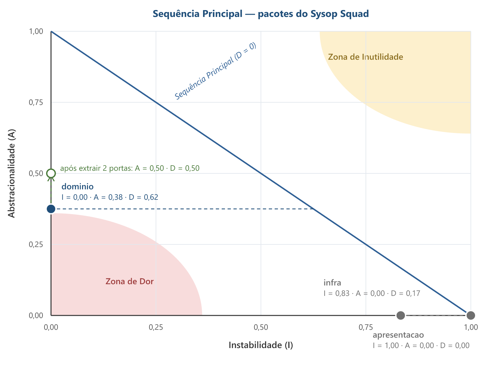

# Validação quantitativa de acoplamento, instabilidade, abstracionalidade e distância

**Equipe Beta:** Rhuan, Lucas Michael, Lucas Delles e Felipe Pampu · **Líder da Sprint 2:** Lucas Michael · **Linguagem:** Python

> Os números abaixo podem ser recalculados a partir do código com `python tools/metricas.py`.

## 1. Mapeamento de módulos

Os três principais pacotes lógicos do sistema derivam diretamente dos contêineres definidos no C4 Nível 2 e da separação entre domínio e infraestrutura formalizada no [ADR 004](adr/ADR-004-isolamento-do-dominio-por-interfaces.md).

**Critério de contagem.** Antes dos cálculos, definiu-se que são consideradas classes as classes concretas, as dataclasses de domínio e as interfaces (`abc.ABC`). Exceções de domínio, como `RoteamentoIndisponivelError`, não entram na contagem. Para Ca e Ce, contabilizam-se classes distintas pertencentes a outros pacotes, e não a quantidade de chamadas. O composition root foi contabilizado como classe do pacote de apresentação.

| Contêiner no C4 Nível 2 | Pacote lógico | Classes e interfaces | Nc | Na | A |
|---|---|---|---|---|---|
| API de Recepção e Consumidor de Chamados | [`apresentacao`](../src/sysop_squad/apresentacao) | RecepcaoDeChamadosAPI, ConsumidorDeChamadosAMQP, ComposicaoDeDependencias (todas concretas) | 3 | 0 | 0,00 |
| Motor de Roteamento | [`dominio`](../src/sysop_squad/dominio) | Chamado, ConsultorCandidato, Reserva, Resultado, MotorDeRoteamento (concretas); RepositorioDeConsultores, RegistroDeDisponibilidade, ProvedorDeRotas (abstratas) | 8 | 3 | 0,38 |
| Banco Geoespacial, Cache de Disponibilidade e API de Mapas | [`infra`](../src/sysop_squad/infra) | ConsultoresPostGISAdapter, DisponibilidadeRedisAdapter, MapsHTTPAdapter (todas concretas) | 3 | 0 | 0,00 |

*Tabela 1 — Mapeamento contêiner → pacote e respectiva abstracionalidade (A = Na / Nc).*

## 2. Cálculo prático de Ca e Ce

- **domínio — Ca = 6, Ce = 0.** Dependem desse pacote ConsultoresPostGISAdapter, DisponibilidadeRedisAdapter, MapsHTTPAdapter, RecepcaoDeChamadosAPI, ConsumidorDeChamadosAMQP e ComposicaoDeDependencias. O pacote não importa nenhuma classe externa, conforme a invariante estabelecida no ADR 004.
- **infra — Ca = 1, Ce = 5.** Somente ComposicaoDeDependencias instancia os adaptadores. Esses adaptadores utilizam RepositorioDeConsultores, RegistroDeDisponibilidade, ProvedorDeRotas, ConsultorCandidato e Reserva.
- **apresentação — Ca = 0, Ce = 5.** Nenhum outro pacote depende da borda do sistema. O pacote utiliza MotorDeRoteamento e Chamado, pertencentes ao domínio, além dos três adaptadores de infra que instancia.

## 3. Cálculo da instabilidade (I), abstracionalidade (A) e distância (D)

```
domínio       I = 0 / (6 + 0) = 0,00   A = 3 / 8 = 0,38   D = |0,38 + 0,00 - 1| = 0,62
infra         I = 5 / (1 + 5) = 0,83   A = 0 / 3 = 0,00   D = |0,00 + 0,83 - 1| = 0,17
apresentação  I = 5 / (0 + 5) = 1,00   A = 0 / 3 = 0,00   D = |0,00 + 1,00 - 1| = 0,00
```

| Pacote | Conexões contadas | Ca | Ce | I | A | D |
|---|---|---|---|---|---|---|
| domínio | Entrada: 3 adaptadores de infra + 3 classes de apresentação. Saída: nenhuma. | 6 | 0 | 0,00 | 0,38 | 0,62 |
| infra | Entrada: ComposicaoDeDependencias. Saída: 3 portas + ConsultorCandidato + Reserva. | 1 | 5 | 0,83 | 0,00 | 0,17 |
| apresentação | Entrada: nenhuma. Saída: MotorDeRoteamento + Chamado + 3 adaptadores. | 0 | 5 | 1,00 | 0,00 | 0,00 |

*Tabela 2 — Métricas dos três pacotes.*

## 4. Identificação de zonas de risco



*Figura 1 — Posicionamento dos três pacotes em relação à Sequência Principal.*

- **Zona de Dor (A ≈ 0 e I ≈ 0):** nenhum pacote está integralmente nessa zona, mas o pacote de domínio encontra-se em sua borda. Com I = 0,00, ele é o componente mais estável do sistema; entretanto, sua abstracionalidade de 0,38 o posiciona a uma distância de 0,62 da Sequência Principal. Isso indica estabilidade elevada em relação ao grau de abstração atual, fazendo com que alterações em regras concretas possam repercutir nos seis dependentes.
- **Zona de Inutilidade (A ≈ 1 e I ≈ 1):** nenhum pacote se encontra nessa região. No desenho atual, não há contratos abstratos sem consumidores.
- **Princípio das Dependências Estáveis:** as dependências seguem o sentido apresentação (I = 1,00) → infra (I = 0,83) → domínio (I = 0,00). Assim, cada dependência aponta para um pacote mais estável, não havendo violação a ser corrigida.
- **Zona de Dor fora do código:** o esquema geoespacial do PostGIS é concreto por natureza e possui muitos dependentes. O ADR 004 já o mantém isolado atrás das portas, impedindo que se torne uma dependência direta do domínio.

### Proposta de refatoração com DIP

Para afastar o pacote de domínio da Zona de Dor, propõe-se a extração de duas abstrações já previstas no diagrama, mas ainda ausentes do código: `RotearChamado`, porta de entrada utilizada pelo consumidor da fila, e `FilaDeTriagemManual`, presente no C4 Nível 2 e ainda não implementada na Sprint 2.

```python
# dominio/portas.py - duas abstrações extraídas
from abc import ABC, abstractmethod

class RotearChamado(ABC):                 # porta de ENTRADA
    @abstractmethod
    def executar(self, chamado) -> Resultado: ...

class FilaDeTriagemManual(ABC):           # porta de SAÍDA (Driver P2)
    @abstractmethod
    def encaminhar(self, chamado_id, motivo) -> None: ...

# dominio/motor.py - o serviço passa a implementar a porta de entrada
class MotorDeRoteamento(RotearChamado):
    def __init__(self, consultores, disponibilidade, rotas,
                 triagem: FilaDeTriagemManual):
        ...

# apresentacao/consumidor.py - depende da abstração, não da classe concreta
class ConsumidorDeChamadosAMQP:
    def __init__(self, canal, motor: RotearChamado):
        self._motor = motor
```

Com a extração proposta, o pacote de domínio passa de Na = 3 e Nc = 8 para Na = 5 e Nc = 10. Com isso, a abstracionalidade aumenta de 0,38 para 0,50, enquanto a distância diminui de 0,62 para 0,50, sem fragmentar o núcleo. O pacote infra passa a incluir o `TriagemAMQPAdapter` e também apresenta melhora, com D reduzido de 0,17 para 0,14, enquanto o pacote de apresentação permanece com D = 0,00.

## 5. ADR 005

Ver [ADR 005](adr/ADR-005-topologia-validada-por-metricas.md).

## 6. Referências

- MARTIN, Robert C. *Clean Architecture*. Prentice Hall, 2017. (Métricas de acoplamento de componentes e Sequência Principal.)
- RICHARDS, Mark; FORD, Neal. *Fundamentals of Software Architecture*. O'Reilly, 2020.
