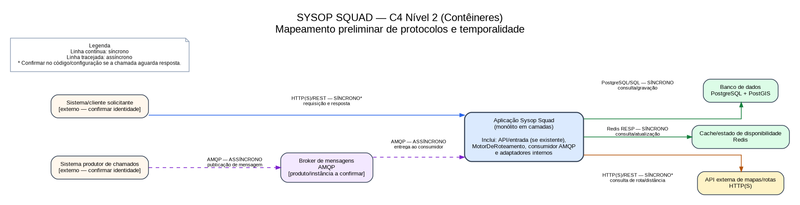
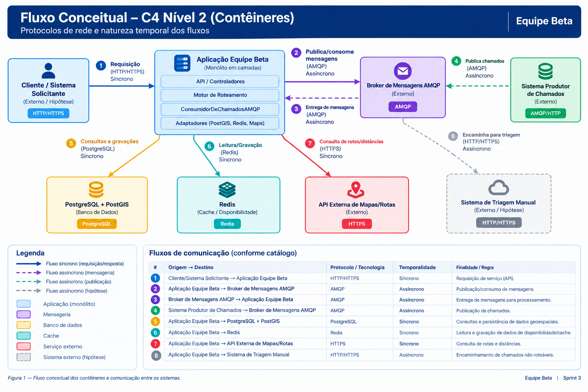
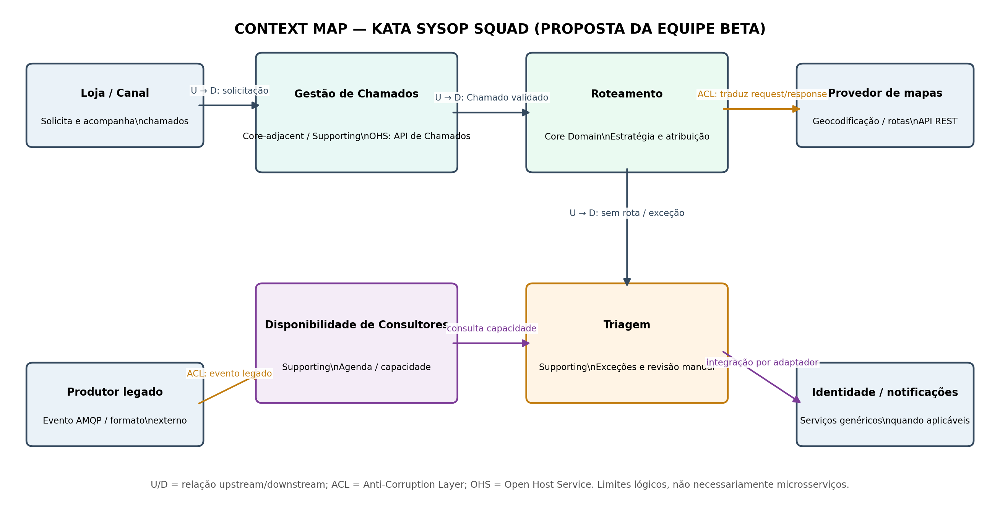
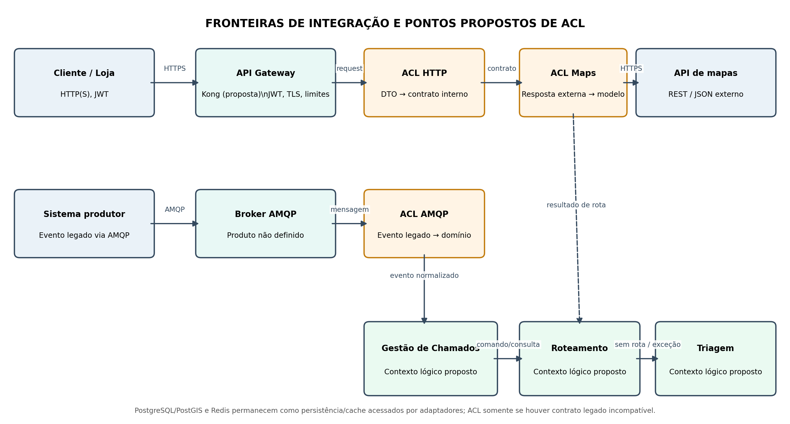
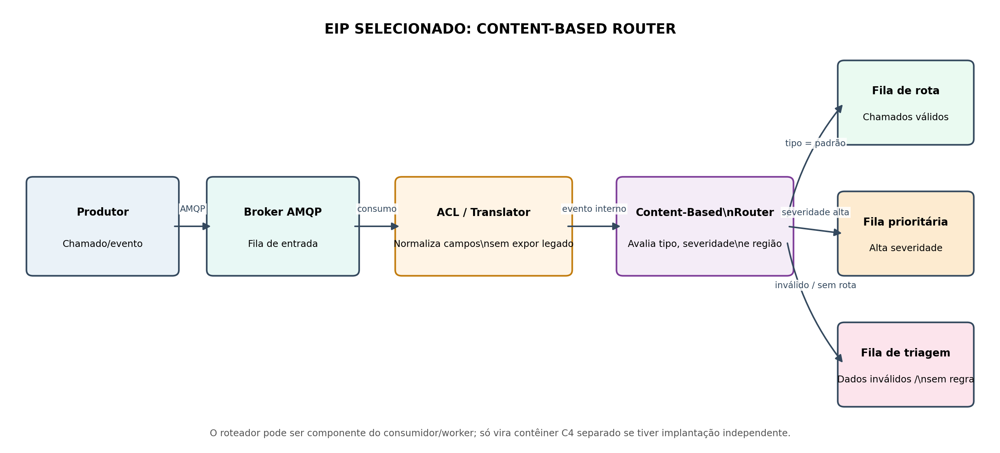

# Sprint 3 — Distribuição, Domínio e Integração

**Projeto:** Sysop Squad · **Equipe Beta:** Rhuan, Lucas Michael, Lucas Delles e Felipe Pampu · **Linguagem:** Python

Nesta sprint a equipe mapeou os fluxos entre contêineres (protocolo e temporalidade), desenhou o contrato de dados do recebimento de chamados, definiu a política de retry e fallback, delimitou os Bounded Contexts, escolheu os padrões de integração, fechou a macroarquitetura e registrou um padrão GoF de cada categoria.

## Roteiro Prático

| Tópico | Entrega | Documento original |
|---|---|---|
| 1 | [Mapeamento C4 Nível 2: protocolos e temporalidade](docs/01-mapeamento-c4-nivel-2.md) | [Mapeamento_C4_Equipe_Beta.docx](entregas/Mapeamento_C4_Equipe_Beta.docx) |
| 2 | [Contrato de Dados (OpenAPI)](docs/02-contrato-de-dados.md) · [chamados.yaml](docs/openapi/chamados.yaml) | [Contrato_de_Dados_Equipe_Beta.docx](entregas/Contrato_de_Dados_Equipe_Beta.docx) |
| 3 | [Política de Retry e Fallback](docs/03-politica-retry-fallback.md) | [Politica_Retry_Fallback_Equipe_Beta.docx](entregas/Politica_Retry_Fallback_Equipe_Beta.docx) |
| 4 | [Registro de Decisão Arquitetural — Retry e Fallback](docs/adr/ADR-retry-e-fallback.md) | [Registro_Decisao_Arquitetural_Equipe_Beta.docx](entregas/Registro_Decisao_Arquitetural_Equipe_Beta.docx) |

## ADRs da Sprint 3

| ADR | Decisão | Status | Documento original |
|---|---|---|---|
| [004](docs/adr/ADR-004-bounded-contexts-e-linguagem-ubiqua.md) | Bounded Contexts, Subdomínios e Linguagem Ubíqua | Proposta | [docx](entregas/ADR_004_Equipe_Beta_Sysop_Squad.docx) |
| [005](docs/adr/ADR-005-frameworks-e-padroes-de-integracao.md) | Frameworks e Padrões de Integração (Kong, JWT, ACL, Content-Based Router) | Proposto | [docx](entregas/ADR_005_Equipe_Beta_Sysop_Squad.docx) |
| [006](docs/adr/ADR-006-macroarquitetura-e-distribuicao-de-dados.md) | Macroarquitetura (Monólito Modular em Camadas) e Distribuição de Dados | Proposta | [docx](entregas/ADR_006_Equipe_Beta_Sysop_Squad.docx) |
| [007](docs/adr/ADR-007-factory-method.md) | Padrão Criacional: Factory Method | Proposta | [docx](entregas/ADR_007_Criacional_Equipe_Beta.docx) |
| [008](docs/adr/ADR-008-adapter.md) | Padrão Estrutural: Adapter | Proposta | [docx](entregas/ADR_008_Estrutural_Equipe_Beta.docx) |
| [009](docs/adr/ADR-009-strategy.md) | Padrão Comportamental: Strategy | Proposta | [docx](entregas/ADR_009_Comportamental_Equipe_Beta.docx) |

> Os ADRs 004 e 005 desta sprint são decisões diferentes dos ADRs 004 e 005 da [Sprint 2](../sprint-2/README.md). Cada sprint mantém a numeração com que foi entregue; o [índice geral](../README.md#7-registros-de-decisões-arquiteturais-adrs) mostra sprint e número juntos.

## Figuras

| Figura | Onde aparece |
|---|---|
|  | Mapeamento C4 (Tópico 1) |
|  | Política de Retry e Fallback (Tópico 3) |
|  | ADR 004 — Context Map |
|  | ADR 005 — Fronteiras de integração e ACLs |
|  | ADR 005 — Content-Based Router |
