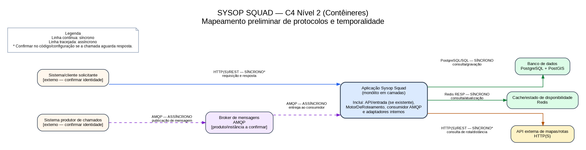

# Mapeamento C4: Nível 2 — Contêineres

**Sprint 3 — Tópico 1** · Protocolos de rede e natureza temporal dos fluxos · Equipe Beta

Documento original: [Mapeamento_C4_Equipe_Beta.docx](../entregas/Mapeamento_C4_Equipe_Beta.docx)

## 1. Objetivo

Mapear os contêineres relevantes do Sysop Squad e as comunicações entre eles, indicando a origem, o destino, o protocolo/tecnologia, a finalidade e a natureza temporal (síncrona ou assíncrona) de cada fluxo. O nível C4-2 descreve aplicações, processos executáveis e armazenamentos de dados; classes e adaptadores internos não devem ser apresentados como contêineres separados se não forem executáveis/deployáveis independentemente.

## 2. Diagrama C4 — Nível 2

*Figura 1 — Mapeamento proposto dos contêineres e fluxos de comunicação.*

## 3. Contêineres representados

| Contêiner / elemento | Responsabilidade | Base / observação |
|---|---|---|
| Aplicação Sysop Squad (monólito em camadas) | Executar regras de negócio, coordenar o MotorDeRoteamento, hospedar adaptadores e consumidor AMQP conforme a organização real do código. | A arquitetura anterior descreve um monólito em camadas e cita MotorDeRoteamento e ConsumidorDeChamadosAMQP. |
| Broker de mensagens AMQP | Receber mensagens publicadas e disponibilizá-las ao consumidor de chamados. | A documentação cita AMQP; produto e topologia exatos devem ser confirmados. |
| PostgreSQL + PostGIS | Persistir dados e oferecer consultas geoespaciais utilizadas no roteamento. | A documentação cita o adaptador PostGIS. |
| Redis | Apoiar consulta/armazenamento de disponibilidade ou estado usado no roteamento. | A documentação cita o adaptador Redis; finalidade e comandos devem ser validados no código. |
| API externa de mapas/rotas | Fornecer dados externos de rota/distância, se essa integração fizer parte do fluxo ativo. | A documentação cita MapsHTTPAdapter; endpoints e modo de chamada devem ser confirmados. |
| Cliente/sistema solicitante | Iniciar uma solicitação por API, se o sistema expuser esse ponto de entrada. | A identidade do cliente e a existência de API externa não estão comprovadas no material disponível. |
| Sistema produtor de chamados | Publicar chamados para processamento assíncrono. | Representado como sistema externo lógico; identificar o produtor real no diagrama/código. |

## 4. Catálogo de fluxos de comunicação

Os fluxos abaixo formam um mapeamento completo para a proposta do diagrama. Os itens assinalados como hipótese devem ser comparados com o C4/código original antes de serem declarados como fatos.

| # | Origem → destino | Protocolo / tecnologia | Temporalidade | Finalidade / regra de classificação |
|---|---|---|---|---|
| 1 | Cliente/sistema solicitante → Aplicação Sysop Squad | HTTP(S)/REST (hipótese) | Síncrono se houver request/response | Enviar uma solicitação e aguardar resposta da aplicação. Confirmar se existe API externa e qual rota/protocolo. |
| 2 | Sistema produtor → Broker AMQP | AMQP | Assíncrono | Publicar um evento/mensagem de chamado para processamento desacoplado. A confirmação técnica de publicação não equivale à conclusão do processamento. |
| 3 | Broker AMQP → ConsumidorDeChamadosAMQP (na aplicação) | AMQP | Assíncrono | Entregar a mensagem ao consumidor. A entrega/ack deve ser confirmada pela configuração do broker e do consumidor. |
| 4 | Aplicação → PostgreSQL/PostGIS | Protocolo PostgreSQL / SQL | Síncrono, normalmente | Consultar ou persistir dados necessários ao roteamento; a aplicação normalmente aguarda o resultado da consulta. |
| 5 | Aplicação → Redis | Protocolo Redis (RESP) | Síncrono, normalmente | Consultar ou atualizar disponibilidade/estado; confirmar se há comandos diretos, pipeline ou mecanismo assíncrono. |
| 6 | Aplicação → API externa de mapas/rotas | HTTP(S)/REST | Síncrono se aguarda resposta HTTP | Obter rota/distância para apoiar o roteamento. Confirmar endpoint, timeout e se a chamada é feita no fluxo principal. |
| 7 | Dentro da aplicação: consumidor AMQP → MotorDeRoteamento | Chamada interna Python | Síncrono se o método é chamado diretamente | O consumidor encaminha o chamado recebido ao motor. É comunicação interna, não uma seta de rede entre contêineres se ambos estiverem no mesmo processo. |
| 8 | Dentro da aplicação: MotorDeRoteamento → adaptadores | Chamadas internas Python/contratos | Síncrono se chamadas diretas | O motor usa os adaptadores de PostGIS, Redis e HTTP. No C4-2, mostrar como interação interna apenas se os adaptadores forem contêineres independentes; caso contrário, detalhar em C4-3. |

## 5. Convenção visual para as setas

- Linha contínua e rótulo "SÍNCRONO": o solicitante aguarda o resultado da operação antes de continuar.
- Linha tracejada e rótulo "ASSÍNCRONO": a mensagem/evento é entregue para processamento independente; o produtor não precisa aguardar o término da regra de negócio.
- Cada seta deve conter o protocolo e uma finalidade curta, por exemplo: "PostgreSQL/SQL — síncrono — consulta de consultores".
- Não classificar somente pelo protocolo: HTTP costuma ser síncrono, mas pode ser usado em fluxos assíncronos; AMQP normalmente suporta mensageria assíncrona, embora existam confirmações e acknowledgements.

## 6. Validações antes da entrega

- Confirmar se existe API/entrada HTTP e qual contêiner a hospeda; se não existir, remover a seta do cliente para a aplicação.
- Identificar o produtor real de mensagens e o broker AMQP utilizado (por exemplo, não assumir RabbitMQ sem evidência).
- Confirmar se ConsumidorDeChamadosAMQP roda no mesmo monólito ou em um worker implantado separadamente. Se for processo separado, representá-lo como contêiner próprio.
- Confirmar o banco e o driver/protocolo de conexão usados pelo adaptador PostGIS.
- Confirmar se Redis é usado para disponibilidade, cache ou ambos e se as operações são diretas/síncronas.
- Confirmar o uso real de MapsHTTPAdapter e se a API de mapas é chamada de forma síncrona.
- Adicionar quaisquer outros contêineres/fluxos presentes no diagrama original, sem deixar setas sem rótulo.
