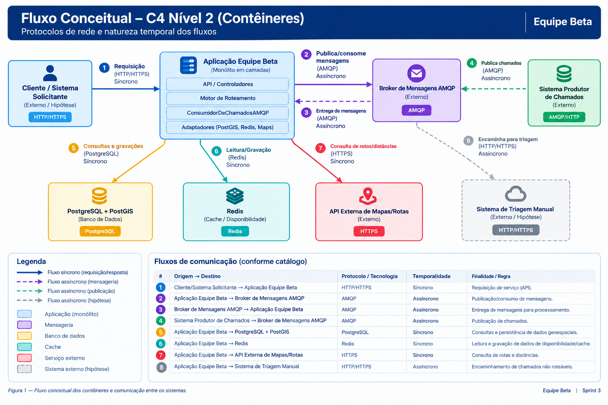

# Política de Retry e Fallback

**Sprint 3 — Tópico 3** · Resiliência, Circuit Breaker e triagem manual · Equipe Beta

Documento original: [Politica_Retry_Fallback_Equipe_Beta.docx](../entregas/Politica_Retry_Fallback_Equipe_Beta.docx)

## 1. Objetivo

Definir a política de retentativa (retry) e fallback da Equipe Beta quando uma dependência externa ou uma etapa do processamento falhar, buscando resiliência sem gerar duplicidade de chamados ou sobrecarga dos serviços.

## 2. Contexto

O sistema recebe chamados por AMQP e utiliza PostgreSQL/PostGIS, Redis e uma API externa de mapas/rotas. A documentação da Sprint 2 prevê que chamados não roteados possam seguir para triagem manual. A instrução da Sprint 3 pede uma política de retry e fallback, incluindo Circuit Breaker. Os materiais não especificam parâmetros já implementados; os valores abaixo são uma proposta inicial.

## 3. Decisão arquitetural

Adotar retentativas limitadas com backoff exponencial e jitter para falhas transitórias. Aplicar Circuit Breaker à integração externa de mapas/rotas para interromper temporariamente chamadas após falhas recorrentes. Se o roteamento não puder ser concluído após as tentativas, ou se o circuito estiver aberto, encaminhar o chamado para triagem manual. Erros permanentes de validação não devem ser repetidos automaticamente.

## 4. Política proposta

- **Retry:** até 3 tentativas no total para falhas transitórias, com espera progressiva e jitter. Exemplo inicial de espera: aproximadamente 1 s e 2 s entre tentativas; validar os valores com testes.
- **Falhas transitórias:** timeout, falha temporária de rede, HTTP 429 e determinados erros 5xx, respeitando `Retry-After` quando disponível.
- **Falhas permanentes:** dados inválidos, requisição malformada e erros de validação não devem ser repetidos sem alteração da entrada.
- **Circuit Breaker:** estados fechado, aberto e half-open; limiar de falhas e tempo de espera devem ser configuráveis e validados.
- **Fallback:** se a integração necessária ao roteamento estiver indisponível, encaminhar o chamado para triagem manual, sem presumir um resultado de rota que não foi obtido.
- **Idempotência:** reprocessar a mesma mensagem não pode gerar múltiplos roteamentos ou múltiplos encaminhamentos para triagem.
- **AMQP:** confirmar a política de ack/nack, reentrega e dead-letter queue conforme o broker e a configuração reais.

## 5. Fluxo de tratamento



*Figura 1 — Fluxo conceitual da arquitetura e das comunicações do sistema.*

Fluxo conceitual:

```
Receber chamado via AMQP
        |
        v
Executar roteamento
        |
        v
Operação falhou?
   | Não             | Sim
   v                 v
Concluir       Falha transitória?
                    | Não          | Sim
                    v              v
             Triagem manual    Retry limitado
                                  |
                                  v
                         Circuito aberto?
                           | Sim     | Não
                           v         v
                    Triagem manual  Tentar novamente
```

A implementação deve distinguir falhas de negócio, falhas transitórias de infraestrutura e falhas permanentes.

## 6. Exemplo em Python

Exemplo simplificado de retry; não implementa Circuit Breaker nem envio para triagem:

```python
import random
import time

def executar_com_retry(operacao, tentativas=3):
    for tentativa in range(tentativas):
        try:
            return operacao()
        except (TimeoutError, ConnectionError):
            if tentativa == tentativas - 1:
                raise
            espera = (2 ** tentativa) + random.uniform(0, 0.25)
            time.sleep(espera)
```

Em produção, adicionar timeouts explícitos, classificação de erros, logging, métricas, idempotência e integração com o fluxo de mensagens.

## 7. Consequências

- **Benefícios:** recuperação de falhas transitórias; menor pressão sobre um serviço degradado; caminho de contingência rastreável.
- **Custos e riscos:** as tentativas aumentam a latência; configurações inadequadas podem amplificar a carga; Circuit Breaker exige monitoramento.
- **Consistência:** idempotência e tratamento de reentrega são necessários para evitar efeitos duplicados.
- **Observabilidade:** registrar tentativas, causa das falhas, estado do circuito, quantidade de chamados enviados à triagem e tempo de resolução.

## 8. Critérios de validação

- Simular timeout, falha de rede, HTTP 429/5xx e erro permanente de validação.
- Confirmar o limite de tentativas e o atraso progressivo.
- Testar abertura e recuperação do Circuit Breaker.
- Confirmar que a triagem manual ocorre uma única vez por chamado.
- Testar redelivery AMQP, ack/nack, idempotência e dead-letter queue se utilizada.
- Medir latência, número de retries e volume da fila de triagem.

## 9. Referência documental

Equipe Beta. Relatório de Arquitetura Sprint 2: fluxo assíncrono AMQP, portas/adaptadores e proposta de FilaDeTriagemManual. Sprint 3 — instrução do Tópico 3: política de retry e fallback com Circuit Breaker.
