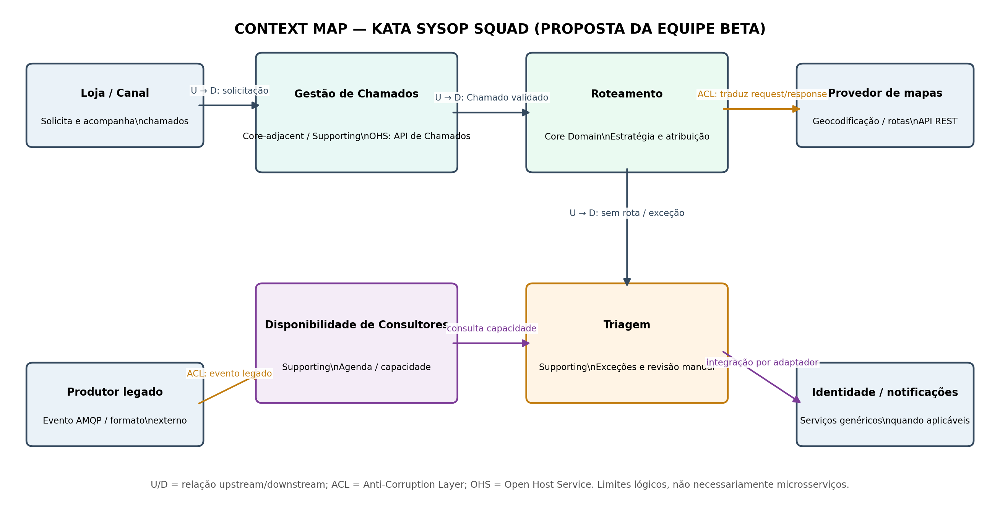

# ADR 004 — Delimitação dos Bounded Contexts e Linguagem Ubíqua

**Equipe Beta** · Projeto-base: Sysop Squad | Architectural Kata — Roteamento de Chamados e Gestão de Incidentes

Documento original: [ADR_004_Equipe_Beta_Sysop_Squad.docx](../../entregas/ADR_004_Equipe_Beta_Sysop_Squad.docx)

## 1. Identificação e status

| Campo | Descrição |
|---|---|
| Identificador | ADR 004 |
| Título | Delimitação dos Bounded Contexts, Subdomínios e Linguagem Ubíqua |
| Status | Proposta para validação da equipe |
| Responsável | Líder da Sprint 3 — Equipe Beta |
| Escopo | Modelo de domínio e relações de integração da Kata Sysop Squad |

## 2. Contexto e problema

A Kata descreve uma solução que recebe chamados originados por lojas e os encaminha ao consultor técnico mais adequado. Sem limites explícitos de domínio, conceitos como chamado, incidente, disponibilidade, região e atribuição podem adquirir significados diferentes entre módulos. Isso provoca modelos inconsistentes, dependência de estruturas externas e dificuldade para evoluir regras de negócio.

A decisão precisa identificar o subdomínio que concentra a vantagem competitiva, separar capacidades de apoio e capacidades genéricas, estabelecer um vocabulário compartilhado e explicitar as relações entre os Bounded Contexts. A modelagem é lógica: não determina automaticamente a divisão em microsserviços.

## 3. Decisão arquitetural

A Equipe Beta propõe reconhecer **Roteamento e Atribuição Inteligente** como Core Domain. Esse contexto concentra a regra diferenciadora da solução: avaliar candidatos e selecionar o consultor elegível mais adequado para o chamado, considerando critérios de negócio como prioridade, proximidade, disponibilidade e região de atendimento. Os critérios exatos devem ser confirmados com o enunciado/especialista da Kata.

| Subdomínio | Classificação | Justificativa |
|---|---|---|
| Roteamento e atribuição inteligente | Core Domain | Concentra a lógica competitiva de seleção do consultor e atribuição do chamado. |
| Gestão do ciclo de vida do chamado | Supporting | Registra, valida, consulta e atualiza o chamado, fornecendo dados ao Core Domain. |
| Triagem e tratamento de exceções | Supporting | Trata dados incompletos, ausência de candidato e situações que exigem intervenção humana. |
| Disponibilidade e capacidade dos consultores | Supporting | Fornece agenda, capacidade, elegibilidade e área de atuação. |
| Autenticação/autorização | Generic | Capacidade comum que pode ser atendida por provedor e bibliotecas consolidadas. |
| Geocodificação/cartografia | Generic | Serviço especializado para coordenadas e cálculo de rotas. |
| Notificações e mensageria técnica | Generic | Infraestrutura de entrega; as regras de quando notificar continuam no domínio. |
| Persistência, cache e observabilidade | Generic | Capacidades técnicas comuns, preferencialmente apoiadas em produtos maduros. |

## 4. Linguagem Ubíqua do Core Domain

Os termos abaixo constituem o vocabulário normativo do Core Domain. Devem ser usados de modo consistente em conversas, histórias, documentação, classes, entidades, atributos, eventos e métodos. Sinônimos não devem ser introduzidos sem revisão do glossário.

| Termo | Definição | Exemplos de nomes no código |
|---|---|---|
| Chamado | Solicitação de uma loja que requer atendimento técnico. | `Chamado`; `registrarChamado()`; `consultarChamado()` |
| Loja | Unidade solicitante e origem do chamado. | `Loja`; `lojaId` |
| Incidente | Ocorrência ou falha descrita no chamado. | `Incidente`; `classificarIncidente()` |
| Consultor | Profissional elegível para receber um chamado. | `Consultor`; `consultorId` |
| Disponibilidade | Condição de agenda/capacidade do consultor. | `Disponibilidade`; `verificarDisponibilidade()` |
| Região de Atendimento | Área geográfica em que o consultor pode atuar. | `RegiaoAtendimento`; `pertenceARegiao()` |
| Roteamento | Avaliação de candidatos e seleção do destino. | `Roteamento`; `calcularRoteamento()` |
| Atribuição | Vínculo confirmado entre chamado e consultor. | `Atribuicao`; `atribuirChamado()` |
| Triagem | Análise de exceções antes da atribuição. | `Triagem`; `encaminharParaTriagem()` |

A implementação pode adotar convenção de código em inglês, se exigida pelo projeto, desde que exista mapeamento único e documentado (por exemplo, Chamado = ServiceCall). Não se deve alternar traduções para o mesmo conceito dentro do mesmo contexto.

## 5. Bounded Contexts e Context Map

São propostos quatro contextos lógicos: Gestão de Chamados, Roteamento, Disponibilidade de Consultores e Triagem. Gestão de Chamados publica o contrato de registro/consulta como Open Host Service (OHS). Roteamento consome o chamado validado e a informação de disponibilidade; exceções são encaminhadas à Triagem.

*Figura 1 — Context Map proposto para a Kata Sysop Squad.*

## 6. Relações, Upstream/Downstream, ACL e OHS

| Relação | Papel U/D | Integração / padrão |
|---|---|---|
| Loja/Canal → Gestão de Chamados | Origem externa → contexto consumidor | Contrato de entrada; validar se canal HTTP ou outro protocolo. |
| Gestão de Chamados → Roteamento | Gestão de Chamados = Upstream; Roteamento = Downstream | Chamado validado por contrato publicado. |
| Disponibilidade de Consultores → Roteamento | Disponibilidade = Upstream; Roteamento = Downstream | Consulta de capacidade/elegibilidade. |
| Roteamento → Triagem | Roteamento encaminha; Triagem recebe | Fluxo de exceção/decisão manual. |
| Produtor legado AMQP → Gestão de Chamados | Sistema externo → contexto interno | ACL para traduzir nomes, códigos e estrutura do evento legado. |
| Provedor externo de mapas ↔ Roteamento | Fornecedor externo ↔ contexto interno | ACL/adaptador para traduzir requisição e resposta do fornecedor. |

O Open Host Service é oferecido pelo contexto Gestão de Chamados por meio do contrato público/versionado de Chamados (por exemplo, o endpoint documentado em OpenAPI, se confirmado como interface publicada). OHS não significa expor entidades internas ou acesso direto ao banco.

A ACL é aplicada na entrada do evento legado AMQP e na integração com o provedor externo de mapas, pois são fronteiras em que formatos, códigos e semânticas externas não devem contaminar o modelo do Core Domain. Para PostgreSQL/PostGIS e Redis, adaptadores de persistência/cache são suficientes; uma ACL adicional só se justifica se existir esquema legado ou incompatibilidade semântica.

## 7. Alternativas consideradas

| Alternativa | Avaliação |
|---|---|
| Um único modelo compartilhado por todos os módulos | Rejeitada: favorece acoplamento semântico e mudanças em um contexto podem afetar os demais. |
| Criar um microsserviço por subdomínio desde o início | Não adotada como consequência automática: Bounded Context é limite de modelo, não obrigação de implantação separada. |
| Compartilhar diretamente o modelo do produtor legado | Rejeitada: faz o domínio depender de nomenclatura e formato externo. |
| Usar ACL nas fronteiras externas/legadas | Selecionada: protege o vocabulário interno, ao custo de tradução e manutenção. |

## 8. Consequências e trade-offs

**Benefícios:** vocabulário mais consistente; maior clareza sobre o que diferencia a solução; regras de roteamento protegidas de detalhes de infraestrutura; contratos mais explícitos entre contextos; e possibilidade de evoluir cada modelo com menor impacto semântico nos demais.

**Custos e riscos:** a definição de limites exige alinhamento contínuo com especialistas; a ACL adiciona código, testes de contrato, mapeamentos e possível latência; OHS exige versionamento, documentação, compatibilidade e monitoramento; a separação dos contextos pode aumentar a complexidade de integração se forem implantados como serviços distintos. Consultas entre contextos podem exigir chamadas de rede ou eventos, com custos de latência, disponibilidade e consistência eventual.

A classificação de disponibilidade como Supporting e de geocodificação como Generic é uma hipótese de modelagem. Se a solução desenvolver uma lógica própria de capacidade ou geointeligência que represente diferencial competitivo, a classificação deve ser revista. Da mesma forma, o desenho não afirma que os contextos já estejam implementados como componentes independentes.

## 9. Critérios de validação e revisão

- Validar os critérios reais de seleção do consultor: prioridade, proximidade, região, disponibilidade e regras de desempate.
- Confirmar os estados oficiais do chamado e o significado operacional de incidente, triagem e atribuição.
- Confirmar se a disponibilidade dos consultores é mantida no sistema ou fornecida por integração externa.
- Confirmar os consumidores reais do contrato OHS e o protocolo de publicação.
- Identificar o produtor legado AMQP, o esquema real das mensagens e os campos que exigem tradução ACL.
- Validar a API/provedor de mapas e quais dados devem ser traduzidos pela ACL.
- Verificar no código se classes, entidades e métodos respeitam o glossário da Linguagem Ubíqua.

## 10. Referências

- EVANS, Eric. *Domain-Driven Design: Tackling Complexity in the Heart of Software*. Boston: Addison-Wesley, 2003.
- VERNON, Vaughn. *Implementing Domain-Driven Design*. Boston: Addison-Wesley, 2013.
- FOWLER, Martin. *Domain Language*. martinfowler.com, material de referência sobre linguagem ubíqua e modelagem de domínio.
