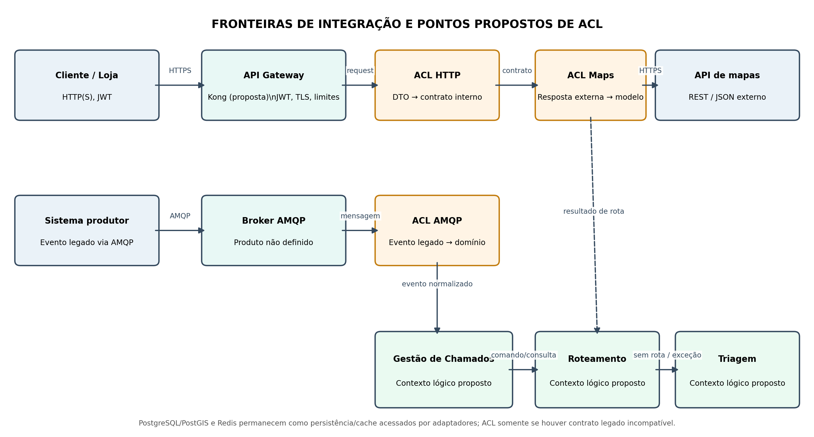
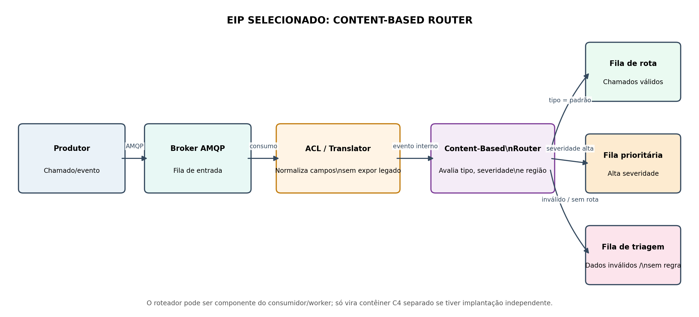

# ADR 005 — Decisão de Frameworks e Padrões de Integração de Sistemas

**Equipe Beta** · Projeto-base: Sysop Squad | Architectural Kata — Roteamento de Chamados e Gestão de Incidentes

Documento original: [ADR_005_Equipe_Beta_Sysop_Squad.docx](../../entregas/ADR_005_Equipe_Beta_Sysop_Squad.docx)

## 1. Identificação e status

| Campo | Descrição |
|---|---|
| Identificador | ADR 005 |
| Título | Decisão de Frameworks e Padrões de Integração de Sistemas |
| Equipe | Equipe Beta |
| Projeto-base | Sysop Squad |
| Status | Proposto — aguardando validação da equipe |
| Escopo | C4 Nível 2, ACL, API Gateway, JWT e mensageria EIP |

## 2. Contexto e problema

A arquitetura documentada do Sysop Squad descreve uma aplicação em camadas, integração assíncrona por AMQP, persistência em PostgreSQL/PostGIS, uso de Redis e integração com uma API externa de mapas/rotas. O mapeamento C4 de nível 2 também registra pontos que ainda precisam de confirmação: existência e escopo de uma API HTTP para clientes/lojas, identidade do produtor de mensagens, produto/topologia do broker e implantação do consumidor AMQP.

Sem fronteiras explícitas, formatos legados podem vazar para o domínio; autenticação e políticas HTTP podem ficar dispersas; e a distribuição de mensagens pode depender de condicionais espalhadas pelo consumidor. A Sprint solicita formalizar as fronteiras de integração, a porta de entrada HTTP e um padrão EIP para um fluxo crítico.

## 3. Decisão arquitetural

A Equipe Beta propõe adotar as seguintes decisões para a evolução da arquitetura, condicionadas à confirmação dos pontos em aberto do C4:

- **API Gateway:** Kong Gateway como ponto de entrada único para a API HTTP(S), caso a exposição externa da API seja confirmada. O Gateway encaminhará requisições ao contêiner da aplicação, sem concentrar regras de negócio.
- **Autenticação e segurança:** validação de JWT no Gateway, incluindo assinatura, `iss`, `aud`, `exp` e escopos; uso de JWKS quando disponível; TLS; rate limiting; validação de requisição; logs sem tokens/dados sensíveis; e rotação segura de chaves. A autorização sobre recursos e lojas permanece na aplicação.
- **ACL:** introduzir uma ACL/Message Translator na entrada AMQP para converter eventos legados em contrato interno canônico; uma ACL de saída para traduzir o modelo de rota/localização para o contrato específico do provedor de mapas; e adaptador de entrada HTTP para mapear DTO público em comandos internos, se a API for confirmada.
- **EIP:** selecionar Content-Based Router no fluxo de entrada de chamados. Após normalização, o roteador avaliará tipo, severidade e região e direcionará a mensagem para fila de processamento de rota, fila prioritária ou fila de triagem manual.

Os contextos lógicos usados para orientar as fronteiras são Gestão de Chamados, Roteamento e Triagem. São Bounded Contexts conceituais propostos, não uma afirmação de que existam três microsserviços. PostgreSQL/PostGIS e Redis continuam acessados por adaptadores; ACL específica só será criada se houver incompatibilidade semântica ou legado a isolar.

*Figura 1 — Fronteiras de integração e posicionamento proposto das ACLs.*

*Figura 2 — Fluxo crítico com Content-Based Router e filas de destino.*

## 4. Alternativas consideradas

- **Sem API Gateway:** rejeitada para uma API pública, pois dispersa autenticação, limitação de taxa e políticas transversais entre os serviços/controladores. É aceitável apenas se não houver API externa.
- **NGINX ou Traefik como proxy de borda:** alternativas viáveis para roteamento e TLS; Kong foi selecionado pela proposta de concentrar políticas de API e validação JWT em plugins/configuração. A escolha deve ser reavaliada conforme infraestrutura, equipe e licenciamento disponíveis.
- **Message Translator sem Content-Based Router:** normaliza contratos, mas não resolve por si só a distribuição por conteúdo para destinos distintos.
- **Aggregator:** útil quando a operação precisa combinar respostas de múltiplas fontes; não é o problema principal do fluxo de entrada de chamados descrito.
- **Roteamento por condicionais espalhadas no consumidor:** rejeitado por elevar acoplamento, dificultar testes e tornar a evolução das regras mais arriscada.

## 5. Consequências, trade-offs e custos

- **Infraestrutura e disponibilidade:** Kong acrescenta um componente de execução, configuração, atualização, monitoramento e possível alta disponibilidade. Sua indisponibilidade pode bloquear a entrada HTTP; portanto, a implantação precisa de health checks, redundância compatível com o ambiente e procedimento de rollback.
- **Rede e latência:** o Gateway adiciona um salto entre cliente e aplicação. O fluxo assíncrono adiciona tráfego entre produtor, broker e consumidor; ACLs podem acrescentar processamento de serialização, validação e tradução. A chamada externa de mapas continua sujeita a latência e disponibilidade do provedor. Não é possível estimar custo financeiro sem volume de requisições/mensagens, região, infraestrutura, SLA e modelo de hospedagem.
- **Segurança:** JWT evita autenticação ad hoc em cada rota, mas exige gestão de chaves, validação correta de claims, expiração curta adequada ao risco e estratégia para revogação. O Gateway não substitui autorização de domínio; a aplicação deve verificar permissões por chamado/loja. Segredos e tokens não devem ser registrados em logs.
- **Manutenção e semântica:** ACLs protegem o domínio de nomes e formatos legados, porém criam mapeamentos adicionais, testes de contrato e trabalho de manutenção quando os sistemas externos mudam. A tradução não deve descartar dados necessários à auditoria; contratos devem ser versionados e erros de mapeamento observáveis.
- **Mensageria e operação:** Content-Based Router torna a distribuição explícita, mas acrescenta regras e filas a monitorar. Redelivery pode duplicar mensagens; o consumidor deve ser idempotente. ACK/NACK, dead-letter queue, retentativas e ordenação dependem do broker AMQP real e precisam ser confirmados antes da implementação. Filas adicionais consomem armazenamento, rede e capacidade operacional.
- **Complexidade total:** a combinação aumenta o número de componentes e políticas a administrar. O benefício esperado é separar segurança de borda, tradução de contratos e roteamento de mensagens; o custo é maior esforço de configuração, testes de integração, observabilidade, documentação e suporte.

## 6. Plano de validação e critérios de aceitação

- Confirmar se existe API HTTP externa, rotas, consumidores e requisitos de autorização.
- Identificar o provedor de identidade e validar emissor, audiência, assinatura, expiração, escopos e rotação de chaves JWT.
- Identificar produtor AMQP, broker, versão, topologia, TLS, credenciais, ACK/NACK, redelivery e dead-letter queue.
- Confirmar o esquema real do evento legado e documentar o mapeamento ACL para o contrato canônico.
- Confirmar API/provedor de mapas, formato de request/response, limites, timeout e política de falha.
- Testar Content-Based Router com mensagens válidas, alta severidade, região não atendida, campos inválidos e duplicidade.
- Medir latência adicionada pelo Gateway e pelo fluxo AMQP; acompanhar throughput, tamanho de filas, erros de tradução e taxa de mensagens em triagem.
- Validar que o domínio não importa tipos ou nomes específicos do produtor legado ou do provedor externo.

## 7. Riscos e medidas de mitigação

- **Adotar Kong antes de confirmar a API:** manter a decisão como proposta até validar a interface externa; se não houver API pública, não implantar Gateway sem necessidade.
- **Regras incorretas no roteador:** manter regras em configuração versionada, testes automatizados e rota de triagem para casos sem correspondência.
- **ACL desatualizada:** versionar contratos, manter testes de contrato com produtores/provedores e alertar falhas de tradução.
- **Duplicidade AMQP:** idempotência por identificador de evento e registro do resultado processado.

## 8. Pontos em aberto e responsabilidades

A decisão não afirma que Kong, um provedor JWT, um broker específico ou as ACLs já estejam implantados. A equipe deve confirmar os fatos de infraestrutura e designar responsáveis por Gateway/segurança, contratos/ACL, regras EIP e observabilidade. O nome do produto do broker AMQP não foi especificado no material-base e, portanto, não é fixado nesta ADR.

## 9. Revisão da decisão

Revisar esta ADR quando a API externa for confirmada ou descartada, quando o broker/produtor AMQP for identificado, quando o provedor de mapas mudar, quando os limites dos Bounded Contexts forem alterados ou quando métricas demonstrarem que a topologia escolhida gera latência/custo desproporcionais. **Status atual:** Proposto — aguarda validação da Equipe Beta.
