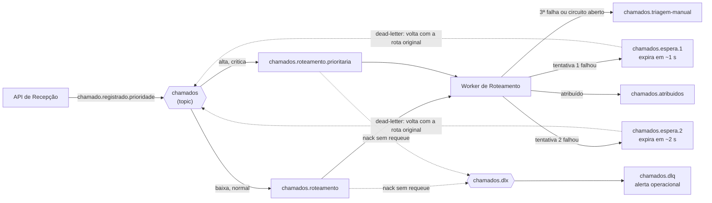

# ADR 010 — Mensageria RabbitMQ com Content-Based Router, Retry Exponencial e DLQ

- **Status:** Aceito (implementado na Sprint 4)
- **Sprint:** 4
- **Relaciona-se com:** ADR 000, ADR 002 (Sprint 1); ADR 005 da Sprint 3 (Content-Based Router); Política de Retry e Fallback e Registro de Decisão de retry (Sprint 3); Drivers P1 e P2

## Contexto

O ADR 002 escolheu usar um Message Broker, mas deixou em aberto "RabbitMQ ou Kafka". Os documentos da Sprint 3 mantiveram o produto como "a confirmar" e definiram a Política de Retry e Fallback: até 3 tentativas com backoff exponencial e jitter, Circuit Breaker na API de Mapas e triagem manual quando o roteamento não puder ser concluído. O desafio final do Sysop Squad pede um pipeline RabbitMQ com Dead Letter Queue e retry exponencial.

O volume é baixo (cerca de 0,37 chamados/s em média e 200 RPS de pico na API, pela estimativa BOTE da Sprint 1). O que importa é não perder chamados aceitos (P1) e não travar a abertura de chamados quando o roteamento falha (P2).

## Decisão

Adotar **RabbitMQ (AMQP 0-9-1)**, com filas duráveis, mensagens persistentes, *publisher confirms* na publicação e *ack* manual no consumo.

### Pipeline

| Elemento | Tipo | Função |
|---|---|---|
| `chamados` | exchange topic | Entrada. Faz o **Content-Based Router** do ADR 005 (Sprint 3) pela prioridade do chamado. |
| `chamados.roteamento` / `.prioritaria` | filas duráveis com DLX | Chamados a rotear. A prioritária pode ter workers dedicados. |
| `chamados.espera.1` / `.2` | exchange fanout + fila sem consumidor | Espera do retry. A mensagem expira e o RabbitMQ a devolve para `chamados` com a mesma chave. |
| `chamados.triagem-manual` | fila durável | Fallback do Driver P2, consumido pelo Painel Operacional. |
| `chamados.atribuidos` | fila durável | Notificação ao consultor. |
| `chamados.dlx` → `chamados.dlq` | exchange fanout + fila | Mensagens irrecuperáveis, com alerta operacional. |

### Política aplicada pelo consumidor

| Situação | O que acontece |
|---|---|
| Falha transitória (`RoteamentoIndisponivelError`) na tentativa 1 ou 2 | Republica em `chamados.espera.N` com `expiration` = 1 s ou 2 s + jitter de até 250 ms e cabeçalho `x-tentativa`; dá *ack* na original. |
| Falha transitória na 3ª tentativa | Encaminha para a triagem manual (`FilaDeTriagemManual`). |
| Circuito da API de Mapas aberto (`CircuitoAbertoError`) | Vai direto para a triagem manual, sem retry (não adianta insistir). |
| Mensagem inválida, chamado não registrado ou erro inesperado | *nack* sem requeue → DLQ. Erro permanente não é repetido. |
| Reentrega de chamado já atribuído ou já triado | Só confirma (*ack*). Idempotência pelo estado do ciclo de vida (ADR 012). |

Parâmetros em [`infra/mensageria.py`](../../src/sysop_squad/infra/mensageria.py): `ESPERAS`, `JITTER_MAXIMO` e `TENTATIVAS_MAXIMAS`.

### Idempotência (entrega "pelo menos uma vez")

- `message_id` = identificador do chamado em todas as mensagens.
- O consumidor só roteia chamados em `REGISTRADO` ou `EM_ROTEAMENTO`.
- A reserva no Redis é idempotente para o mesmo chamado: reprocessar não reserva um segundo consultor.
- O evento de triagem usa `message_id = triagem-<id>`, para o Painel descartar duplicatas.

## Alternativas consideradas

- **Kafka:** rejeitado. Retry com espera e DLQ exigem tópicos e consumidores extras escritos à mão, e o volume do BOTE não pede o throughput do Kafka. O RabbitMQ tem *ack* por mensagem e dead-letter nativos.
- **Retry dentro do consumidor com `sleep`:** rejeitado. Segura a mensagem e o *prefetch* durante a espera e perde a tentativa se o processo cair.
- **Plugin `rabbitmq_delayed_message_exchange`:** rejeitado. Exige plugin instalado no broker; TTL + dead-letter é recurso nativo.
- **Uma só fila de espera com TTL por mensagem:** rejeitado. O RabbitMQ só expira a mensagem do início da fila; mensagens de 2 s atrasariam as de 1 s. Com uma fila por tentativa, a diferença fica limitada ao jitter.

## Consequências

- **Positivo:** nenhum chamado aceito se perde (fila durável + confirms + ack manual). Falhas curtas se resolvem sozinhas. A triagem recebe o chamado em no máximo ~3,5 s após a primeira falha, ou na hora se o circuito estiver aberto. A prioridade alta tem fila própria.
- **Negativo:** mais filas para monitorar (tamanho da DLQ, da triagem e das filas de espera). O consumidor precisa ser idempotente. Ainda falta o padrão *outbox*: se o broker cair entre o registro no banco e a publicação, a API responde 503 e apaga o registro para a loja reenviar.

## Governança

- Testes: [`tests/test_consumidor.py`](../../tests/test_consumidor.py) cobre 1ª, 2ª e 3ª falha, circuito aberto, DLQ e reentrega. [`tests/test_topologia.py`](../../tests/test_topologia.py) cobre filas, ligações e dead-letter.
- Alertas recomendados: DLQ com qualquer mensagem; fila de triagem crescendo; mensagens nas filas de espera por mais de 1 minuto.
