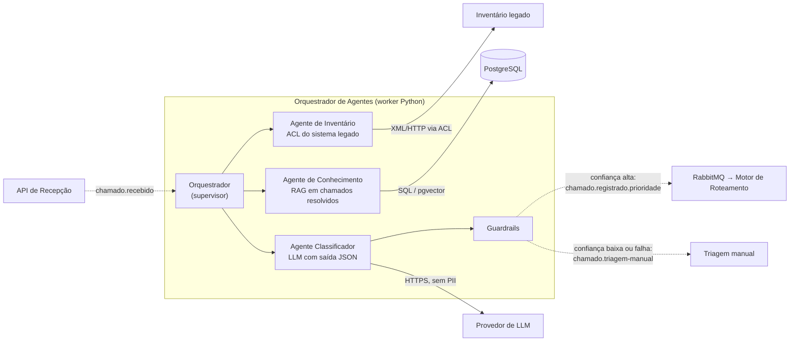

# ADR 011 — Ecossistema de Agentes de IA para Triagem e Classificação de Chamados

- **Status:** Proposto (projetado na Sprint 4; ainda não implementado no código)
- **Sprint:** 4
- **Relaciona-se com:** ADR 004 da Sprint 3 (Bounded Contexts e ACL), ADR 010 (mensageria), Driver P3 (LGPD)

## Contexto

O desafio final do Sysop Squad pede triagem e roteamento inteligente de chamados com **classificação por IA multi-agente**, integrada a **sistemas legados de inventário**.

Hoje a loja informa no Contrato de Dados a categoria, a prioridade e, quando sabe, as habilidades necessárias. Na prática a descrição é texto livre ("caixa 02 não inicia"), as habilidades vêm incompletas e a prioridade é subjetiva. Isso gera:
- chamados enviados à triagem manual por falta de habilidade;
- consultores errados;
- prioridade mal calibrada.

Dois limites vêm das decisões anteriores:
- o Motor de Roteamento é o Core Domain e precisa continuar **determinístico e auditável**;
- a API precisa responder em até 500 ms (P1) e não pode depender de um modelo de linguagem.

## Decisão

Adotar um **orquestrador com agentes especializados**, fora do caminho crítico da API, que enriquece o chamado antes do roteamento. **A IA recomenda; quem decide a atribuição continua sendo o Motor de Roteamento.**

| Agente | O que faz | Tipo |
|---|---|---|
| **Orquestrador** | Coordena os agentes, aplica os guardrails e decide entre seguir para o roteamento ou para a triagem manual. | Código determinístico |
| **Agente de Inventário** | Busca no sistema legado o equipamento da loja (tipo, modelo, garantia, histórico) e traduz os códigos legados para o vocabulário do domínio. É a **Camada Anti-Corrupção** do inventário. | Ferramenta determinística (Adapter) |
| **Agente de Conhecimento** | Recupera chamados resolvidos parecidos (RAG com `pgvector` no PostgreSQL já existente, ADR 006 da Sprint 3) para dar contexto ao classificador e sugerir solução ao consultor. | Busca vetorial |
| **Agente Classificador** | Lê descrição, categoria, equipamento e casos parecidos e devolve `categoria`, `severidade`, `habilidadesNecessarias` e `confianca`. | LLM com *model tiering*: modelo pequeno primeiro; modelo maior só quando a confiança fica baixa |

### Guardrails

1. **Saída estruturada:** a resposta do LLM é validada contra um JSON Schema; fora do schema conta como falha.
2. **Lista fechada:** só são aceitas habilidades e categorias do catálogo interno. O LLM não inventa habilidade nova.
3. **Limiar de confiança:** abaixo de 0,7 (ajustável), o chamado vai para a triagem manual com a sugestão da IA anexada.
4. **LGPD (P3):** nomes, telefones, e-mails e CPF são removidos da descrição antes de sair para o provedor. A localização não é enviada ao LLM.
5. **Resiliência:** timeout e Circuit Breaker no provedor de LLM, igual à API de Mapas (ADR 010). Se a IA falhar, vale a classificação informada pela loja (fallback por regras).
6. **Prioridade:** a IA só pode **aumentar** a prioridade informada pela loja, nunca baixar.
7. **Auditoria:** registrar versão do modelo, prompt (sem PII), resposta e decisão, para avaliar acurácia e calibrar o limiar.

### Integração com o que já existe

Na implementação da Sprint 4, a API publica direto em `chamado.registrado.<prioridade>`. Com este ADR, a API passa a publicar em `chamado.recebido`. O orquestrador consome, enriquece e republica em `chamado.registrado.<prioridade>`. **O roteamento não muda**: o worker, o Motor de Roteamento, o retry e a DLQ continuam iguais.

## Alternativas consideradas

- **Um único agente LLM fazendo tudo, inclusive escolher o consultor:** rejeitada. Tira o determinismo do Core Domain, dificulta a auditoria, coloca latência e custo no caminho de cada atribuição e não garante a reserva atômica (P1).
- **Só regras fixas (palavras-chave):** rejeitada como solução principal, porque o texto livre varia muito. Fica como fallback.
- **Classificador treinado (*fine-tuning*):** adiada. Exige base rotulada que ainda não existe; os registros de auditoria deste ADR vão formar essa base.
- **IA dentro da API, antes do 202:** rejeitada. Quebraria a meta de 500 ms do P1 e tornaria a abertura de chamado dependente do provedor de LLM.

## Consequências

- **Positivo:**
  - menos chamados na triagem por falta de habilidade;
  - prioridade mais consistente;
  - o inventário legado fica isolado atrás da ACL;
  - o consultor recebe casos parecidos já resolvidos.
- **Negativo:**
  - custo por token;
  - resposta não determinística, que exige monitoramento de acurácia e deriva;
  - mais um worker e mais uma fila para operar;
  - atraso de alguns segundos entre o 202 e o roteamento;
  - dependência de um provedor externo, mitigada pelo fallback.

## Critérios de validação

- Avaliar o classificador num conjunto de chamados rotulados antes de ligar em produção: acurácia de habilidades e taxa de envio para a triagem.
- Testar respostas fora do schema, habilidade fora do catálogo, timeout, circuito aberto e PII na descrição.
- Medir o tempo entre o 202 e a atribuição, com e sem IA.
