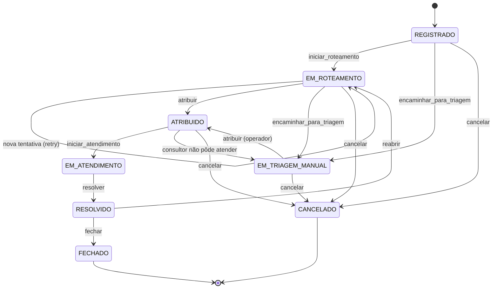

# ADR 012 — Padrão State no Ciclo de Vida do Chamado

- **Status:** Aceito (implementado na Sprint 4)
- **Sprint:** 4
- **Relaciona-se com:** ADR 004 e ADR 006 da Sprint 3 (Bounded Contexts e módulos); ADR 005 da Sprint 2 (métricas); ADR 010 (idempotência do consumidor)

## Contexto

O ADR 004 da Sprint 3 pediu para confirmar os estados oficiais do chamado. O consumidor da fila precisa saber se um chamado ainda pode ser roteado, para não rotear nem triar duas vezes a mesma mensagem (ADR 010). Sem um modelo explícito, o status vira um texto comparado em `if/else` espalhados pela API, pelo consumidor e pelo Painel, e qualquer transição nova exige mexer em todos eles. O desafio final do Sysop Squad pede o padrão GoF State no ciclo de vida dos chamados.

## Decisão

Implementar o ciclo de vida com o **padrão State** no módulo **Gestão de Chamados** (pacote `chamados`), separado do Core Domain de Roteamento, como prevê a macroarquitetura (ADR 006 da Sprint 3).

| Papel do padrão | Classe | Arquivo |
|---|---|---|
| State (interface) | `EstadoDoChamado`: toda ação começa recusada com `TransicaoInvalidaError` | [`chamados/ciclo_de_vida.py`](../../src/sysop_squad/chamados/ciclo_de_vida.py) |
| ConcreteState | `Registrado`, `EmRoteamento`, `EmTriagemManual`, `Atribuido`, `EmAtendimento`, `Resolvido`, `Fechado` e `Cancelado`; cada uma só implementa as transições permitidas | mesmo arquivo |
| Context | `CicloDeVidaDoChamado`: guarda o estado atual e o histórico e delega cada ação ao estado | mesmo arquivo |
| Persistência | `RepositorioDeChamados` (porta) e `ChamadosPostgresAdapter`; grava o nome do estado e o histórico | [`chamados/portas.py`](../../src/sysop_squad/chamados/portas.py), [`infra/chamados_postgres.py`](../../src/sysop_squad/infra/chamados_postgres.py) |

Quem usa:
- A **API** cria o ciclo em `REGISTRADO` ao aceitar o chamado.
- O **consumidor** pergunta `aceita_roteamento` antes de rotear (idempotência) e aplica `atribuir` ou `encaminhar_para_triagem` conforme o resultado.

## Alternativas consideradas

- **Enum de status com `if/else`:** rejeitada. As regras de transição ficam espalhadas e é fácil esquecer um caso; um estado novo exige revisar todo o código que compara status.
- **Biblioteca de máquina de estados (ex.: `transitions`):** rejeitada. Coloca uma dependência externa no módulo de domínio, o que o ADR 004 da Sprint 2 proíbe, e esconde as regras em configuração.
- **Event Sourcing do chamado:** adiada. Daria auditoria completa, mas exige outra forma de persistência; o histórico gravado junto com o estado já atende a necessidade atual.

## Consequências

- **Positivo:**
  - uma transição inválida falha na hora e com mensagem clara;
  - um estado novo vira uma classe nova (OCP);
  - o consumidor ganha idempotência sem `if` sobre texto;
  - o histórico de estados é gravado em todo chamado.
- **Negativo:** são 10 classes para algo que antes era um texto.
- **Métricas** (`python tools/metricas.py`):
  - O pacote `chamados` tem I = 0,00, A = 0,18 e D = 0,82, perto da Zona de Dor: é concreto e estável.
  - Isso é aceito porque só 3 classes dependem dele (Ca = 3) e porque mudanças nos estados ficam localizadas numa classe.
  - Revisar se Ca passar de 5 ou se os estados mudarem a cada sprint.
- **Efeito no domínio:**
  - Deixar o State fora do pacote `dominio` manteve o Core Domain em D = 0,50.
  - Com isso, a invariante 3 do ADR 005 da Sprint 2 foi cumprida, depois da extração de `RotearChamado` e `FilaDeTriagemManual`.

## Validação

[`tests/test_ciclo_de_vida.py`](../../tests/test_ciclo_de_vida.py) cobre:
- o caminho completo até `FECHADO`;
- a ida para a triagem e a atribuição pelo operador;
- o retry no mesmo estado;
- a reabertura;
- as transições inválidas;
- os estados finais;
- a restauração a partir do banco.

[`tests/test_consumidor.py`](../../tests/test_consumidor.py) cobre a reentrega de chamados já resolvidos.
