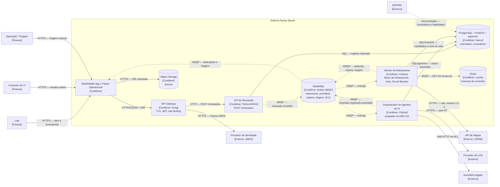

# C4 Nível 2 — Contêineres (arquitetura final)

Convenção da Sprint 3: **linha contínua = síncrono**, **linha tracejada = assíncrono**. Cada seta tem protocolo e finalidade.

> **Implementado x projetado.** O código da Sprint 4 implementa a API de Recepção, o Worker de Roteamento, a topologia do RabbitMQ e os adaptadores de PostgreSQL/PostGIS, Redis e Mapas. Nele, a API publica direto em `chamado.registrado.<prioridade>`. O Orquestrador de IA, o inventário legado e o `pgvector` estão projetados no [ADR 011](adr/ADR-011-ecossistema-de-agentes-de-ia.md); quando entrarem, a API passa a publicar em `chamado.recebido`.

## Contêineres

| Contêiner | Tecnologia | Responsabilidade | Decisão |
|---|---|---|---|
| Web/Mobile App e Painel | SPA / app móvel | Abrir e acompanhar chamados; painel de triagem manual | Sprint 1 |
| API Gateway | Kong | Entrada única HTTPS; JWT, TLS, rate limiting, limite de upload | ADR 005 (Sprint 3), ADR 001 |
| API de Recepção | Python (WSGI) | Valida o Contrato de Dados, registra e publica; responde 202 | ADR 000, ADR 002, Contrato de Dados |
| Orquestrador de Agentes de IA | Python | Classifica e enriquece o chamado antes do roteamento | ADR 011 (projetado) |
| Worker de Roteamento | Python | Motor de Roteamento, retry exponencial, Circuit Breaker, ciclo de vida | ADR 010, ADR 012 |
| RabbitMQ | AMQP 0-9-1 | Filas duráveis, Content-Based Router, espera do retry, DLQ | ADR 010 |
| PostgreSQL + PostGIS + pgvector | SQL | Chamados (ciclo de vida), consultores e posição; vetores para RAG | ADR 003, ADR 006 (Sprint 3) |
| Redis | RESP | Reserva atômica de consultor (`SET NX` com expiração) | ADR 003 |
| Object Storage | S3 ou equivalente | Anexos fotográficos | ADR 001 |

## Monólito modular

Seguindo o ADR 006 da Sprint 3, a API de Recepção e o Worker de Roteamento são **o mesmo código** ([`src/sysop_squad`](../src/sysop_squad)) iniciado em dois modos:
- `python -m sysop_squad.apresentacao.composicao api`;
- `python -m sysop_squad.apresentacao.composicao consumidor`.

Assim cada parte pode ser escalada separadamente sem virar microsserviço. Os componentes internos estão no [C4 Nível 3](c4-nivel3.md).
