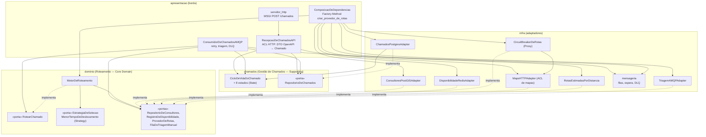

# C4 Nível 3 — Componentes da aplicação (API de Recepção e Worker de Roteamento)

As setas apontam no sentido da dependência de código. Nenhuma seta sai do `dominio` nem do `chamados` para fora: é a regra que o import-linter e `tests/test_arquitetura.py` verificam.

| Componente | Arquivo | Padrão |
|---|---|---|
| `RecepcaoDeChamadosAPI` | [`apresentacao/api.py`](../src/sysop_squad/apresentacao/api.py) | ACL de entrada (Adapter) |
| `ConsumidorDeChamadosAMQP` | [`apresentacao/consumidor.py`](../src/sysop_squad/apresentacao/consumidor.py) | Retry exponencial + fallback |
| `ComposicaoDeDependencias` | [`apresentacao/composicao.py`](../src/sysop_squad/apresentacao/composicao.py) | Factory Method parametrizado |
| `CicloDeVidaDoChamado` | [`chamados/ciclo_de_vida.py`](../src/sysop_squad/chamados/ciclo_de_vida.py) | State |
| `MotorDeRoteamento` | [`dominio/motor.py`](../src/sysop_squad/dominio/motor.py) | DIP (recebe portas e estratégia) |
| `MenorTempoDeDeslocamento` | [`dominio/estrategias.py`](../src/sysop_squad/dominio/estrategias.py) | Strategy |
| Adaptadores | [`infra/`](../src/sysop_squad/infra) | Adapter |
| `CircuitBreakerDeRotas` | [`infra/circuit_breaker.py`](../src/sysop_squad/infra/circuit_breaker.py) | Proxy + Circuit Breaker |
